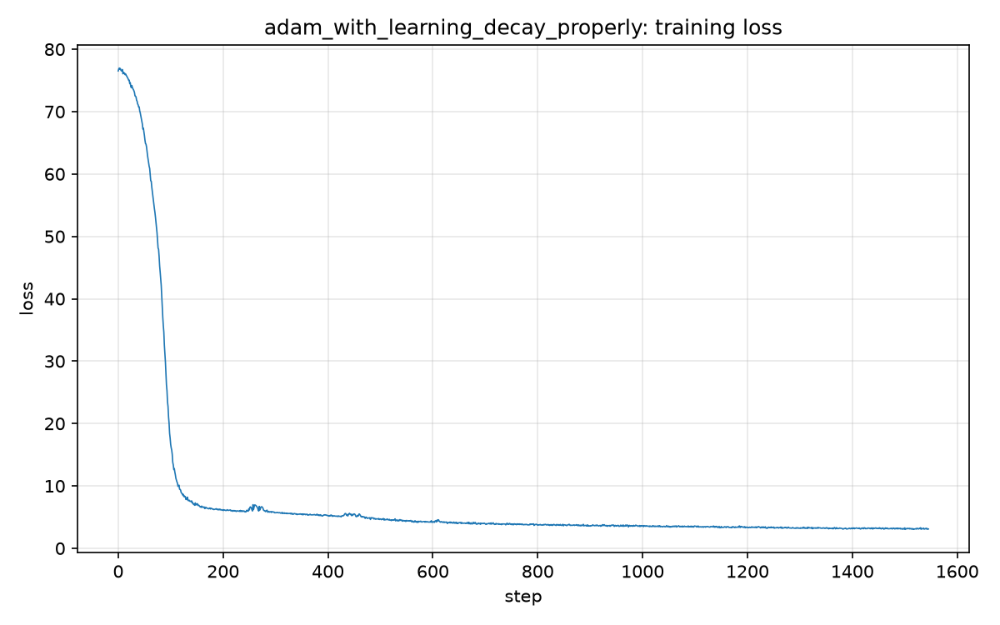

# Experiment: adam_with_learning_decay_properly

## Timing

- **Training start time:** 2026-10-14 13:21:10
- **Training end time:** 2026-10-14 13:54:24
- **Total training time:** 0h 33m 13.9s (1993.9 s)
- **Steps completed:** 1545 (step 0 to 1544)
- **Status:** interrupted (Ctrl-C) before reaching the final step

### Per-step time

| statistic | seconds |
| --- | --- |
| mean (excluding first step) | 1.2754 |
| median | 1.2723 |
| min | 1.2553 |
| max | 2.2599 |
| first step (includes compile) | 2.6071 |

## Hyperparameters

| name | value |
| --- | --- |
| optimizer | AdamW only |
| lr_min | 0.0008 |
| lr_max | 0.008 |
| Tw (warmup steps) | 500 |
| Tc (cosine cycle steps) | 4000 |
| weight_decay | 0.1 |
| total steps | 5000 |
| batch_size | 64 |
| max_seq | 256 |
| d_model | 512 |
| num_heads | 16 |
| num_layers | 4 |
| d_ff | 1344 |
| vocab_size | 10000 |
| rope theta | 10000 |
| device | mps |
| dtype | torch.float32 |

## Loss

- **Initial loss:** 76.5215
- **Final loss:** 3.0999
- **Mean of last 100 steps:** 3.1538
- **Min loss:** 3.0335

