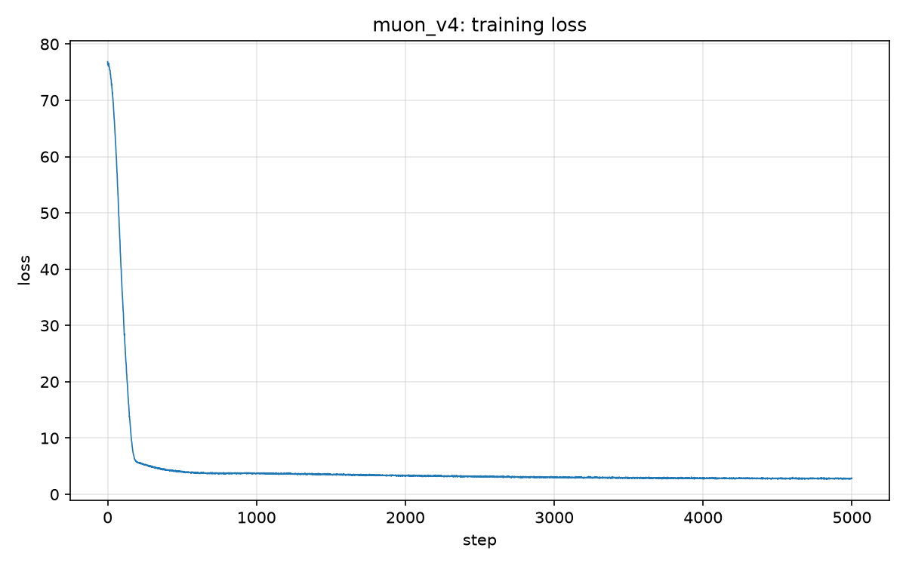

# Experiment: muon_v4

## Timing

- **Training start time:** 2026-10-13 14:55:16
- **Training end time:** 2026-10-13 16:47:24
- **Total training time:** 1h 52m 8.1s (6728.1 s)
- **Steps completed:** 5000 (step 0 to 4999)

### Per-step time

| statistic | seconds |
| --- | --- |
| mean (excluding first step) | 1.3074 |
| median | 1.3032 |
| min | 1.2577 |
| max | 2.3303 |
| first step (includes compile) | 3.1061 |

## Hyperparameters

| name | value |
| --- | --- |
| lr_min | 0.0002 |
| lr_max | 0.02 |
| Tw (warmup steps) | 300 |
| Tc (cosine cycle steps) | 4000 |
| weight_decay | 0.005 |
| total steps | 5000 |
| batch_size | 64 |
| max_seq | 256 |
| d_model | 512 |
| num_heads | 16 |
| num_layers | 4 |
| d_ff | 1344 |
| vocab_size | 10000 |
| rope theta | 10000 |
| device | mps |
| dtype | torch.float32 |

## Loss

- **Initial loss:** 76.8769
- **Final loss:** 2.8187
- **Mean of last 100 steps:** 2.8002
- **Min loss:** 2.6527

