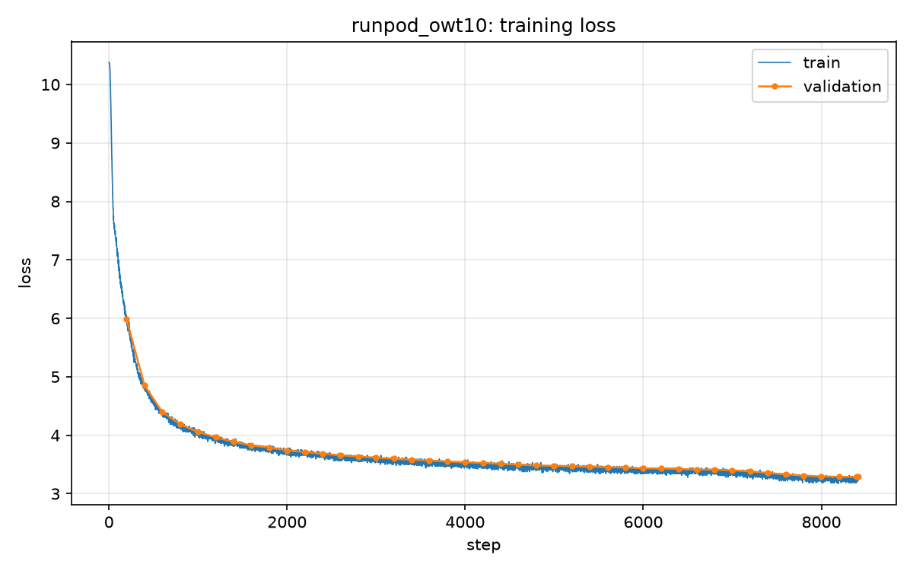

# Experiment: runpod_owt10

## Brief summary

first validation tracking

## Timing

- **Training start time:** 2026-10-24 21:51:54
- **Training end time:** 2026-10-24 22:37:32
- **Total training time:** 0h 45m 1.9s (2701.9 s)
- **Steps completed:** 8417 (step 0 to 8416)
- **Validation time (excluded from budget):** 0h 0m 36.1s (36.1 s)

### Per-step time

| statistic | seconds |
| --- | --- |
| mean (excluding first step) | 0.3179 |
| median | 0.3154 |
| min | 0.3057 |
| max | 19.8509 |
| first step (includes compile) | 24.5568 |

## Hyperparameters

| name | value |
| --- | --- |
| schedule | hybrid (step warmup + time decay) |
| mode | time |
| optimizer | AdamW only |
| lr_min | 0.00015 |
| lr_max | 0.0015 |
| weight_decay | 0.1 |
| batch_size | 256 |
| grad_accum_steps | 1 |
| effective_batch_size | 256 |
| max_seq | 512 |
| d_model | 1024 |
| num_heads | 16 |
| num_layers | 12 |
| d_ff | 2688 |
| vocab_size | 32000 |
| rope theta | 10000 |
| device | cuda |
| dtype | torch.bfloat16 |
| dataset | opentext |
| vocab_path | vocabulary_owt_train.pkl |
| encoded_path | encoded_owt_train.pkl |
| time_budget_seconds | 2700 |
| time_budget_minutes | 45.0 |
| Tw (warmup steps) | 500 |
| decay_sec | 540.0 |
| decay_fraction_of_budget | 0.2 |
| validation | every 200 steps on 20 x 32 fixed sequences |

## Full-step MFU

- **Peak TFLOPS (denominator):** 2250
- **Warmup steps discarded:** 15
- **Valid post-warmup steps:** 8402
- **Terminal print window:** 20 steps
- **FLOP model:** 4x_fwd_with_recompute (bwd window includes +1× forward recompute from activation checkpointing)

### Overall average (all valid steps)

| phase | latency_ms | TFLOPS | MFU% |
| --- | --- | --- | --- |
| Forward | 123.938 | 342.71 | 15.23% |
| Backward | 176.106 | 723.50 | 32.16% |
| Full step | 300.044 | 566.19 | 25.16% |

### Per-window averages

| window | n | fwd_ms | bwd_ms | step_ms | fwd_MFU% | bwd_MFU% | step_MFU% |
| --- | --- | --- | --- | --- | --- | --- | --- |
| 1 | 20 | 120.193 | 172.841 | 293.034 | 15.71% | 32.76% | 25.77% |
| 2 | 20 | 119.840 | 172.952 | 292.792 | 15.75% | 32.74% | 25.79% |
| 3 | 20 | 122.044 | 174.173 | 296.217 | 15.47% | 32.51% | 25.49% |
| 4 | 20 | 122.355 | 174.708 | 297.062 | 15.43% | 32.41% | 25.42% |
| 5 | 20 | 123.055 | 175.371 | 298.427 | 15.34% | 32.29% | 25.30% |
| 6 | 20 | 124.012 | 175.733 | 299.745 | 15.22% | 32.22% | 25.19% |
| 7 | 20 | 123.607 | 175.910 | 299.516 | 15.27% | 32.19% | 25.21% |
| 8 | 20 | 123.219 | 176.144 | 299.364 | 15.32% | 32.15% | 25.22% |
| 9 | 20 | 123.580 | 176.397 | 299.977 | 15.27% | 32.10% | 25.17% |
| 10 | 20 | 123.512 | 176.059 | 299.571 | 15.28% | 32.16% | 25.20% |
| 11 | 20 | 123.889 | 175.931 | 299.821 | 15.24% | 32.19% | 25.18% |
| 12 | 20 | 123.610 | 176.483 | 300.093 | 15.27% | 32.09% | 25.16% |
| 13 | 20 | 123.938 | 175.859 | 299.797 | 15.23% | 32.20% | 25.18% |
| 14 | 20 | 123.925 | 176.139 | 300.063 | 15.23% | 32.15% | 25.16% |
| 15 | 20 | 124.072 | 176.184 | 300.256 | 15.21% | 32.14% | 25.15% |
| 16 | 20 | 124.427 | 176.119 | 300.546 | 15.17% | 32.15% | 25.12% |
| 17 | 20 | 123.896 | 175.971 | 299.867 | 15.24% | 32.18% | 25.18% |
| 18 | 20 | 123.907 | 176.133 | 300.040 | 15.23% | 32.15% | 25.16% |
| 19 | 20 | 123.841 | 176.556 | 300.397 | 15.24% | 32.07% | 25.13% |
| 20 | 20 | 123.827 | 175.908 | 299.736 | 15.25% | 32.19% | 25.19% |
| 21 | 20 | 124.245 | 176.084 | 300.329 | 15.19% | 32.16% | 25.14% |
| 22 | 20 | 124.223 | 176.146 | 300.369 | 15.20% | 32.15% | 25.14% |
| 23 | 20 | 123.910 | 176.339 | 300.249 | 15.24% | 32.11% | 25.15% |
| 24 | 20 | 124.054 | 176.397 | 300.451 | 15.22% | 32.10% | 25.13% |
| 25 | 20 | 124.201 | 176.151 | 300.352 | 15.20% | 32.15% | 25.14% |
| 26 | 20 | 124.274 | 176.214 | 300.488 | 15.19% | 32.14% | 25.13% |
| 27 | 20 | 124.213 | 176.293 | 300.506 | 15.20% | 32.12% | 25.13% |
| 28 | 20 | 123.870 | 175.829 | 299.699 | 15.24% | 32.21% | 25.19% |
| 29 | 20 | 123.795 | 176.403 | 300.198 | 15.25% | 32.10% | 25.15% |
| 30 | 20 | 124.191 | 176.111 | 300.302 | 15.20% | 32.15% | 25.14% |
| 31 | 20 | 124.026 | 176.281 | 300.307 | 15.22% | 32.12% | 25.14% |
| 32 | 20 | 123.735 | 176.210 | 299.945 | 15.26% | 32.14% | 25.17% |
| 33 | 20 | 124.213 | 176.308 | 300.521 | 15.20% | 32.12% | 25.12% |
| 34 | 20 | 124.153 | 175.967 | 300.120 | 15.21% | 32.18% | 25.16% |
| 35 | 20 | 124.180 | 176.539 | 300.719 | 15.20% | 32.08% | 25.11% |
| 36 | 20 | 123.926 | 175.922 | 299.848 | 15.23% | 32.19% | 25.18% |
| 37 | 20 | 124.087 | 176.499 | 300.586 | 15.21% | 32.08% | 25.12% |
| 38 | 20 | 124.397 | 176.289 | 300.686 | 15.17% | 32.12% | 25.11% |
| 39 | 20 | 123.850 | 175.888 | 299.738 | 15.24% | 32.19% | 25.19% |
| 40 | 20 | 123.815 | 175.957 | 299.772 | 15.25% | 32.18% | 25.19% |
| 41 | 20 | 124.254 | 176.308 | 300.562 | 15.19% | 32.12% | 25.12% |
| 42 | 20 | 124.112 | 176.253 | 300.365 | 15.21% | 32.13% | 25.14% |
| 43 | 20 | 124.149 | 175.846 | 299.994 | 15.21% | 32.20% | 25.17% |
| 44 | 20 | 124.213 | 176.322 | 300.535 | 15.20% | 32.12% | 25.12% |
| 45 | 20 | 123.891 | 175.825 | 299.715 | 15.24% | 32.21% | 25.19% |
| 46 | 20 | 123.976 | 176.414 | 300.389 | 15.23% | 32.10% | 25.13% |
| 47 | 20 | 124.784 | 176.035 | 300.819 | 15.13% | 32.17% | 25.10% |
| 48 | 20 | 123.974 | 176.153 | 300.128 | 15.23% | 32.15% | 25.16% |
| 49 | 20 | 124.656 | 176.270 | 300.925 | 15.14% | 32.13% | 25.09% |
| 50 | 20 | 123.621 | 175.857 | 299.478 | 15.27% | 32.20% | 25.21% |
| 51 | 20 | 123.965 | 176.152 | 300.117 | 15.23% | 32.15% | 25.16% |
| 52 | 20 | 124.215 | 175.987 | 300.202 | 15.20% | 32.18% | 25.15% |
| 53 | 20 | 124.229 | 176.010 | 300.240 | 15.20% | 32.17% | 25.15% |
| 54 | 20 | 123.678 | 175.831 | 299.509 | 15.26% | 32.21% | 25.21% |
| 55 | 20 | 124.297 | 176.310 | 300.606 | 15.19% | 32.12% | 25.12% |
| 56 | 20 | 123.982 | 176.326 | 300.309 | 15.22% | 32.12% | 25.14% |
| 57 | 20 | 124.659 | 176.201 | 300.859 | 15.14% | 32.14% | 25.10% |
| 58 | 20 | 123.978 | 176.294 | 300.272 | 15.23% | 32.12% | 25.15% |
| 59 | 20 | 124.461 | 176.378 | 300.839 | 15.17% | 32.11% | 25.10% |
| 60 | 20 | 124.362 | 176.457 | 300.819 | 15.18% | 32.09% | 25.10% |
| 61 | 20 | 123.887 | 175.949 | 299.836 | 15.24% | 32.18% | 25.18% |
| 62 | 20 | 123.955 | 175.674 | 299.629 | 15.23% | 32.23% | 25.20% |
| 63 | 20 | 123.891 | 176.500 | 300.391 | 15.24% | 32.08% | 25.13% |
| 64 | 20 | 123.702 | 176.618 | 300.320 | 15.26% | 32.06% | 25.14% |
| 65 | 20 | 123.978 | 176.196 | 300.174 | 15.23% | 32.14% | 25.15% |
| 66 | 20 | 124.302 | 176.147 | 300.449 | 15.19% | 32.15% | 25.13% |
| 67 | 20 | 123.812 | 176.092 | 299.904 | 15.25% | 32.16% | 25.18% |
| 68 | 20 | 123.889 | 175.661 | 299.550 | 15.24% | 32.24% | 25.20% |
| 69 | 20 | 124.109 | 175.991 | 300.099 | 15.21% | 32.18% | 25.16% |
| 70 | 20 | 124.208 | 176.127 | 300.335 | 15.20% | 32.15% | 25.14% |
| 71 | 20 | 123.852 | 175.913 | 299.765 | 15.24% | 32.19% | 25.19% |
| 72 | 20 | 124.041 | 176.415 | 300.455 | 15.22% | 32.10% | 25.13% |
| 73 | 20 | 124.201 | 176.406 | 300.608 | 15.20% | 32.10% | 25.12% |
| 74 | 20 | 124.090 | 176.396 | 300.485 | 15.21% | 32.10% | 25.13% |
| 75 | 20 | 124.115 | 176.101 | 300.215 | 15.21% | 32.16% | 25.15% |
| 76 | 20 | 123.749 | 176.131 | 299.880 | 15.25% | 32.15% | 25.18% |
| 77 | 20 | 123.858 | 176.232 | 300.089 | 15.24% | 32.13% | 25.16% |
| 78 | 20 | 124.475 | 176.101 | 300.577 | 15.17% | 32.16% | 25.12% |
| 79 | 20 | 124.289 | 175.658 | 299.947 | 15.19% | 32.24% | 25.17% |
| 80 | 20 | 123.673 | 176.015 | 299.688 | 15.26% | 32.17% | 25.19% |
| 81 | 20 | 124.189 | 176.616 | 300.805 | 15.20% | 32.06% | 25.10% |
| 82 | 20 | 124.033 | 175.926 | 299.959 | 15.22% | 32.19% | 25.17% |
| 83 | 20 | 124.013 | 176.479 | 300.493 | 15.22% | 32.09% | 25.13% |
| 84 | 20 | 123.976 | 176.726 | 300.701 | 15.23% | 32.04% | 25.11% |
| 85 | 20 | 124.022 | 176.030 | 300.052 | 15.22% | 32.17% | 25.16% |
| 86 | 20 | 124.090 | 176.413 | 300.503 | 15.21% | 32.10% | 25.13% |
| 87 | 20 | 124.196 | 175.905 | 300.101 | 15.20% | 32.19% | 25.16% |
| 88 | 20 | 124.203 | 175.958 | 300.161 | 15.20% | 32.18% | 25.15% |
| 89 | 20 | 123.649 | 176.437 | 300.086 | 15.27% | 32.10% | 25.16% |
| 90 | 20 | 124.055 | 176.050 | 300.105 | 15.22% | 32.17% | 25.16% |
| 91 | 20 | 123.996 | 176.010 | 300.006 | 15.22% | 32.17% | 25.17% |
| 92 | 20 | 123.983 | 176.350 | 300.332 | 15.23% | 32.11% | 25.14% |
| 93 | 20 | 123.986 | 176.371 | 300.357 | 15.23% | 32.11% | 25.14% |
| 94 | 20 | 123.971 | 176.569 | 300.540 | 15.23% | 32.07% | 25.12% |
| 95 | 20 | 123.423 | 176.236 | 299.658 | 15.29% | 32.13% | 25.20% |
| 96 | 20 | 123.776 | 176.401 | 300.177 | 15.25% | 32.10% | 25.15% |
| 97 | 20 | 123.753 | 176.008 | 299.761 | 15.25% | 32.17% | 25.19% |
| 98 | 20 | 124.351 | 176.459 | 300.810 | 15.18% | 32.09% | 25.10% |
| 99 | 20 | 124.213 | 176.592 | 300.805 | 15.20% | 32.07% | 25.10% |
| 100 | 20 | 124.043 | 176.253 | 300.296 | 15.22% | 32.13% | 25.14% |
| 101 | 20 | 124.272 | 176.168 | 300.441 | 15.19% | 32.14% | 25.13% |
| 102 | 20 | 123.656 | 175.905 | 299.562 | 15.27% | 32.19% | 25.20% |
| 103 | 20 | 123.979 | 175.964 | 299.944 | 15.23% | 32.18% | 25.17% |
| 104 | 20 | 124.366 | 176.266 | 300.632 | 15.18% | 32.13% | 25.11% |
| 105 | 20 | 123.899 | 175.942 | 299.841 | 15.24% | 32.19% | 25.18% |
| 106 | 20 | 124.043 | 176.152 | 300.195 | 15.22% | 32.15% | 25.15% |
| 107 | 20 | 123.633 | 176.075 | 299.707 | 15.27% | 32.16% | 25.19% |
| 108 | 20 | 124.186 | 176.180 | 300.366 | 15.20% | 32.14% | 25.14% |
| 109 | 20 | 124.262 | 176.248 | 300.511 | 15.19% | 32.13% | 25.13% |
| 110 | 20 | 123.927 | 175.804 | 299.731 | 15.23% | 32.21% | 25.19% |
| 111 | 20 | 124.323 | 176.453 | 300.776 | 15.19% | 32.09% | 25.10% |
| 112 | 20 | 124.408 | 176.239 | 300.647 | 15.17% | 32.13% | 25.11% |
| 113 | 20 | 124.464 | 175.813 | 300.277 | 15.17% | 32.21% | 25.14% |
| 114 | 20 | 124.069 | 176.512 | 300.581 | 15.21% | 32.08% | 25.12% |
| 115 | 20 | 124.240 | 176.552 | 300.792 | 15.19% | 32.07% | 25.10% |
| 116 | 20 | 123.593 | 175.936 | 299.529 | 15.27% | 32.19% | 25.21% |
| 117 | 20 | 124.026 | 176.111 | 300.137 | 15.22% | 32.15% | 25.16% |
| 118 | 20 | 123.983 | 175.945 | 299.928 | 15.23% | 32.18% | 25.17% |
| 119 | 20 | 124.143 | 176.126 | 300.268 | 15.21% | 32.15% | 25.14% |
| 120 | 20 | 124.156 | 175.921 | 300.077 | 15.20% | 32.19% | 25.16% |
| 121 | 20 | 124.172 | 176.215 | 300.387 | 15.20% | 32.14% | 25.14% |
| 122 | 20 | 123.853 | 176.161 | 300.014 | 15.24% | 32.15% | 25.17% |
| 123 | 20 | 123.728 | 176.299 | 300.028 | 15.26% | 32.12% | 25.16% |
| 124 | 20 | 124.631 | 176.352 | 300.982 | 15.15% | 32.11% | 25.09% |
| 125 | 20 | 123.859 | 176.196 | 300.055 | 15.24% | 32.14% | 25.16% |
| 126 | 20 | 124.087 | 176.205 | 300.292 | 15.21% | 32.14% | 25.14% |
| 127 | 20 | 124.158 | 176.302 | 300.460 | 15.20% | 32.12% | 25.13% |
| 128 | 20 | 123.991 | 175.705 | 299.696 | 15.22% | 32.23% | 25.19% |
| 129 | 20 | 124.280 | 176.181 | 300.460 | 15.19% | 32.14% | 25.13% |
| 130 | 20 | 124.137 | 176.591 | 300.728 | 15.21% | 32.07% | 25.11% |
| 131 | 20 | 124.024 | 176.032 | 300.056 | 15.22% | 32.17% | 25.16% |
| 132 | 20 | 124.227 | 176.351 | 300.578 | 15.20% | 32.11% | 25.12% |
| 133 | 20 | 124.598 | 176.183 | 300.781 | 15.15% | 32.14% | 25.10% |
| 134 | 20 | 124.168 | 175.982 | 300.150 | 15.21% | 32.18% | 25.16% |
| 135 | 20 | 124.502 | 175.564 | 300.066 | 15.16% | 32.25% | 25.16% |
| 136 | 20 | 123.970 | 176.171 | 300.140 | 15.23% | 32.14% | 25.16% |
| 137 | 20 | 124.020 | 176.270 | 300.290 | 15.22% | 32.13% | 25.14% |
| 138 | 20 | 123.871 | 176.000 | 299.870 | 15.24% | 32.17% | 25.18% |
| 139 | 20 | 123.893 | 176.037 | 299.930 | 15.24% | 32.17% | 25.17% |
| 140 | 20 | 123.835 | 176.034 | 299.869 | 15.24% | 32.17% | 25.18% |
| 141 | 20 | 123.939 | 176.186 | 300.125 | 15.23% | 32.14% | 25.16% |
| 142 | 20 | 124.074 | 176.139 | 300.212 | 15.21% | 32.15% | 25.15% |
| 143 | 20 | 124.115 | 176.249 | 300.364 | 15.21% | 32.13% | 25.14% |
| 144 | 20 | 123.989 | 176.264 | 300.253 | 15.22% | 32.13% | 25.15% |
| 145 | 20 | 124.350 | 176.407 | 300.757 | 15.18% | 32.10% | 25.10% |
| 146 | 20 | 124.247 | 176.395 | 300.642 | 15.19% | 32.10% | 25.11% |
| 147 | 20 | 124.033 | 176.668 | 300.701 | 15.22% | 32.05% | 25.11% |
| 148 | 20 | 124.360 | 176.153 | 300.514 | 15.18% | 32.15% | 25.12% |
| 149 | 20 | 124.046 | 176.671 | 300.718 | 15.22% | 32.05% | 25.11% |
| 150 | 20 | 124.477 | 176.521 | 300.998 | 15.17% | 32.08% | 25.08% |
| 151 | 20 | 123.677 | 176.084 | 299.761 | 15.26% | 32.16% | 25.19% |
| 152 | 20 | 124.384 | 176.295 | 300.679 | 15.18% | 32.12% | 25.11% |
| 153 | 20 | 124.083 | 176.056 | 300.139 | 15.21% | 32.17% | 25.16% |
| 154 | 20 | 124.161 | 176.571 | 300.732 | 15.20% | 32.07% | 25.11% |
| 155 | 20 | 123.641 | 175.852 | 299.493 | 15.27% | 32.20% | 25.21% |
| 156 | 20 | 124.316 | 176.064 | 300.379 | 15.18% | 32.16% | 25.14% |
| 157 | 20 | 124.212 | 176.466 | 300.679 | 15.20% | 32.09% | 25.11% |
| 158 | 20 | 124.153 | 176.314 | 300.467 | 15.20% | 32.12% | 25.13% |
| 159 | 20 | 124.080 | 176.317 | 300.397 | 15.21% | 32.12% | 25.13% |
| 160 | 20 | 124.088 | 176.084 | 300.172 | 15.21% | 32.16% | 25.15% |
| 161 | 20 | 124.185 | 175.981 | 300.166 | 15.20% | 32.18% | 25.15% |
| 162 | 20 | 123.806 | 175.994 | 299.799 | 15.25% | 32.18% | 25.18% |
| 163 | 20 | 124.130 | 176.091 | 300.222 | 15.21% | 32.16% | 25.15% |
| 164 | 20 | 124.108 | 175.881 | 299.989 | 15.21% | 32.20% | 25.17% |
| 165 | 20 | 124.049 | 176.170 | 300.219 | 15.22% | 32.14% | 25.15% |
| 166 | 20 | 123.750 | 176.042 | 299.792 | 15.25% | 32.17% | 25.18% |
| 167 | 20 | 123.685 | 176.170 | 299.855 | 15.26% | 32.14% | 25.18% |
| 168 | 20 | 124.133 | 176.514 | 300.647 | 15.21% | 32.08% | 25.11% |
| 169 | 20 | 123.925 | 176.322 | 300.247 | 15.23% | 32.12% | 25.15% |
| 170 | 20 | 123.499 | 176.414 | 299.913 | 15.28% | 32.10% | 25.17% |
| 171 | 20 | 123.846 | 176.382 | 300.228 | 15.24% | 32.10% | 25.15% |
| 172 | 20 | 123.950 | 175.871 | 299.821 | 15.23% | 32.20% | 25.18% |
| 173 | 20 | 123.779 | 176.057 | 299.836 | 15.25% | 32.16% | 25.18% |
| 174 | 20 | 124.332 | 176.550 | 300.881 | 15.18% | 32.07% | 25.09% |
| 175 | 20 | 124.264 | 176.066 | 300.331 | 15.19% | 32.16% | 25.14% |
| 176 | 20 | 124.438 | 176.437 | 300.875 | 15.17% | 32.09% | 25.09% |
| 177 | 20 | 124.036 | 176.147 | 300.182 | 15.22% | 32.15% | 25.15% |
| 178 | 20 | 123.748 | 176.024 | 299.773 | 15.25% | 32.17% | 25.19% |
| 179 | 20 | 123.833 | 176.481 | 300.314 | 15.24% | 32.09% | 25.14% |
| 180 | 20 | 123.807 | 175.911 | 299.718 | 15.25% | 32.19% | 25.19% |
| 181 | 20 | 124.275 | 175.885 | 300.160 | 15.19% | 32.19% | 25.15% |
| 182 | 20 | 123.570 | 176.141 | 299.711 | 15.28% | 32.15% | 25.19% |
| 183 | 20 | 123.793 | 176.250 | 300.043 | 15.25% | 32.13% | 25.16% |
| 184 | 20 | 123.947 | 176.125 | 300.072 | 15.23% | 32.15% | 25.16% |
| 185 | 20 | 123.790 | 175.827 | 299.617 | 15.25% | 32.21% | 25.20% |
| 186 | 20 | 124.137 | 176.185 | 300.323 | 15.21% | 32.14% | 25.14% |
| 187 | 20 | 123.893 | 176.322 | 300.215 | 15.24% | 32.12% | 25.15% |
| 188 | 20 | 124.174 | 175.939 | 300.113 | 15.20% | 32.19% | 25.16% |
| 189 | 20 | 123.469 | 176.048 | 299.517 | 15.29% | 32.17% | 25.21% |
| 190 | 20 | 124.218 | 176.159 | 300.377 | 15.20% | 32.15% | 25.14% |
| 191 | 20 | 124.138 | 176.113 | 300.252 | 15.21% | 32.15% | 25.15% |
| 192 | 20 | 124.393 | 176.302 | 300.695 | 15.18% | 32.12% | 25.11% |
| 193 | 20 | 124.400 | 176.228 | 300.629 | 15.18% | 32.13% | 25.12% |
| 194 | 20 | 123.713 | 176.093 | 299.807 | 15.26% | 32.16% | 25.18% |
| 195 | 20 | 123.940 | 176.087 | 300.027 | 15.23% | 32.16% | 25.17% |
| 196 | 20 | 123.808 | 175.910 | 299.718 | 15.25% | 32.19% | 25.19% |
| 197 | 20 | 124.092 | 176.879 | 300.972 | 15.21% | 32.02% | 25.09% |
| 198 | 20 | 124.095 | 175.978 | 300.073 | 15.21% | 32.18% | 25.16% |
| 199 | 20 | 124.333 | 176.328 | 300.662 | 15.18% | 32.11% | 25.11% |
| 200 | 20 | 124.275 | 176.358 | 300.633 | 15.19% | 32.11% | 25.11% |
| 201 | 20 | 123.825 | 176.599 | 300.424 | 15.24% | 32.07% | 25.13% |
| 202 | 20 | 124.433 | 176.211 | 300.644 | 15.17% | 32.14% | 25.11% |
| 203 | 20 | 123.736 | 176.211 | 299.947 | 15.26% | 32.14% | 25.17% |
| 204 | 20 | 124.212 | 175.986 | 300.198 | 15.20% | 32.18% | 25.15% |
| 205 | 20 | 123.963 | 176.370 | 300.333 | 15.23% | 32.11% | 25.14% |
| 206 | 20 | 123.947 | 176.391 | 300.338 | 15.23% | 32.10% | 25.14% |
| 207 | 20 | 124.028 | 176.051 | 300.079 | 15.22% | 32.16% | 25.16% |
| 208 | 20 | 123.954 | 176.591 | 300.545 | 15.23% | 32.07% | 25.12% |
| 209 | 20 | 124.404 | 176.090 | 300.494 | 15.18% | 32.16% | 25.13% |
| 210 | 20 | 123.916 | 175.941 | 299.856 | 15.23% | 32.19% | 25.18% |
| 211 | 20 | 124.476 | 176.610 | 301.087 | 15.17% | 32.06% | 25.08% |
| 212 | 20 | 123.942 | 175.984 | 299.926 | 15.23% | 32.18% | 25.17% |
| 213 | 20 | 124.072 | 176.417 | 300.489 | 15.21% | 32.10% | 25.13% |
| 214 | 20 | 123.934 | 176.221 | 300.155 | 15.23% | 32.13% | 25.15% |
| 215 | 20 | 124.159 | 176.164 | 300.323 | 15.20% | 32.14% | 25.14% |
| 216 | 20 | 124.056 | 176.276 | 300.332 | 15.22% | 32.12% | 25.14% |
| 217 | 20 | 123.673 | 176.370 | 300.044 | 15.26% | 32.11% | 25.16% |
| 218 | 20 | 124.136 | 176.325 | 300.461 | 15.21% | 32.12% | 25.13% |
| 219 | 20 | 123.787 | 176.086 | 299.873 | 15.25% | 32.16% | 25.18% |
| 220 | 20 | 123.742 | 176.232 | 299.974 | 15.26% | 32.13% | 25.17% |
| 221 | 20 | 123.824 | 176.315 | 300.139 | 15.25% | 32.12% | 25.16% |
| 222 | 20 | 124.826 | 176.209 | 301.035 | 15.13% | 32.14% | 25.08% |
| 223 | 20 | 124.042 | 176.212 | 300.254 | 15.22% | 32.14% | 25.15% |
| 224 | 20 | 123.664 | 176.403 | 300.067 | 15.26% | 32.10% | 25.16% |
| 225 | 20 | 123.933 | 176.175 | 300.109 | 15.23% | 32.14% | 25.16% |
| 226 | 20 | 123.801 | 176.282 | 300.082 | 15.25% | 32.12% | 25.16% |
| 227 | 20 | 124.159 | 176.227 | 300.386 | 15.20% | 32.13% | 25.13% |
| 228 | 20 | 124.002 | 176.191 | 300.193 | 15.22% | 32.14% | 25.15% |
| 229 | 20 | 124.256 | 176.270 | 300.526 | 15.19% | 32.13% | 25.12% |
| 230 | 20 | 123.784 | 175.891 | 299.675 | 15.25% | 32.20% | 25.20% |
| 231 | 20 | 124.023 | 176.391 | 300.414 | 15.22% | 32.10% | 25.13% |
| 232 | 20 | 124.179 | 176.268 | 300.446 | 15.20% | 32.13% | 25.13% |
| 233 | 20 | 123.696 | 176.139 | 299.836 | 15.26% | 32.15% | 25.18% |
| 234 | 20 | 124.159 | 176.075 | 300.234 | 15.20% | 32.16% | 25.15% |
| 235 | 20 | 124.063 | 176.255 | 300.318 | 15.22% | 32.13% | 25.14% |
| 236 | 20 | 123.805 | 176.240 | 300.045 | 15.25% | 32.13% | 25.16% |
| 237 | 20 | 123.787 | 176.250 | 300.036 | 15.25% | 32.13% | 25.16% |
| 238 | 20 | 123.728 | 175.731 | 299.458 | 15.26% | 32.22% | 25.21% |
| 239 | 20 | 123.595 | 176.014 | 299.609 | 15.27% | 32.17% | 25.20% |
| 240 | 20 | 124.173 | 176.061 | 300.234 | 15.20% | 32.16% | 25.15% |
| 241 | 20 | 124.030 | 176.138 | 300.168 | 15.22% | 32.15% | 25.15% |
| 242 | 20 | 123.787 | 176.209 | 299.996 | 15.25% | 32.14% | 25.17% |
| 243 | 20 | 123.919 | 176.031 | 299.949 | 15.23% | 32.17% | 25.17% |
| 244 | 20 | 124.476 | 175.924 | 300.400 | 15.17% | 32.19% | 25.13% |
| 245 | 20 | 124.207 | 176.090 | 300.297 | 15.20% | 32.16% | 25.14% |
| 246 | 20 | 123.624 | 175.723 | 299.347 | 15.27% | 32.22% | 25.22% |
| 247 | 20 | 123.919 | 175.928 | 299.847 | 15.23% | 32.19% | 25.18% |
| 248 | 20 | 123.933 | 175.664 | 299.598 | 15.23% | 32.24% | 25.20% |
| 249 | 20 | 123.903 | 175.385 | 299.288 | 15.24% | 32.29% | 25.23% |
| 250 | 20 | 123.934 | 176.027 | 299.961 | 15.23% | 32.17% | 25.17% |
| 251 | 20 | 124.431 | 176.047 | 300.478 | 15.18% | 32.17% | 25.13% |
| 252 | 20 | 124.022 | 176.233 | 300.255 | 15.22% | 32.13% | 25.15% |
| 253 | 20 | 124.162 | 176.392 | 300.554 | 15.20% | 32.11% | 25.12% |
| 254 | 20 | 124.051 | 176.126 | 300.177 | 15.22% | 32.15% | 25.15% |
| 255 | 20 | 123.957 | 175.897 | 299.853 | 15.23% | 32.19% | 25.18% |
| 256 | 20 | 123.671 | 176.306 | 299.976 | 15.26% | 32.12% | 25.17% |
| 257 | 20 | 123.774 | 176.197 | 299.971 | 15.25% | 32.14% | 25.17% |
| 258 | 20 | 123.724 | 176.331 | 300.055 | 15.26% | 32.11% | 25.16% |
| 259 | 20 | 124.168 | 175.909 | 300.077 | 15.20% | 32.19% | 25.16% |
| 260 | 20 | 123.310 | 175.961 | 299.271 | 15.31% | 32.18% | 25.23% |
| 261 | 20 | 123.898 | 176.072 | 299.969 | 15.24% | 32.16% | 25.17% |
| 262 | 20 | 123.901 | 175.837 | 299.739 | 15.24% | 32.20% | 25.19% |
| 263 | 20 | 123.722 | 176.066 | 299.788 | 15.26% | 32.16% | 25.19% |
| 264 | 20 | 123.700 | 175.847 | 299.547 | 15.26% | 32.20% | 25.21% |
| 265 | 20 | 123.741 | 175.781 | 299.522 | 15.26% | 32.21% | 25.21% |
| 266 | 20 | 123.941 | 176.397 | 300.338 | 15.23% | 32.10% | 25.14% |
| 267 | 20 | 123.956 | 175.833 | 299.790 | 15.23% | 32.21% | 25.19% |
| 268 | 20 | 123.769 | 176.064 | 299.833 | 15.25% | 32.16% | 25.18% |
| 269 | 20 | 123.628 | 176.145 | 299.774 | 15.27% | 32.15% | 25.19% |
| 270 | 20 | 123.516 | 175.679 | 299.195 | 15.28% | 32.23% | 25.24% |
| 271 | 20 | 123.394 | 176.174 | 299.568 | 15.30% | 32.14% | 25.20% |
| 272 | 20 | 123.520 | 176.043 | 299.563 | 15.28% | 32.17% | 25.20% |
| 273 | 20 | 123.749 | 176.034 | 299.783 | 15.25% | 32.17% | 25.19% |
| 274 | 20 | 124.019 | 175.644 | 299.663 | 15.22% | 32.24% | 25.20% |
| 275 | 20 | 123.679 | 176.349 | 300.028 | 15.26% | 32.11% | 25.17% |
| 276 | 20 | 123.608 | 175.414 | 299.022 | 15.27% | 32.28% | 25.25% |
| 277 | 20 | 123.413 | 175.602 | 299.015 | 15.30% | 32.25% | 25.25% |
| 278 | 20 | 123.966 | 176.341 | 300.306 | 15.23% | 32.11% | 25.14% |
| 279 | 20 | 123.491 | 175.653 | 299.144 | 15.29% | 32.24% | 25.24% |
| 280 | 20 | 123.272 | 175.537 | 298.809 | 15.31% | 32.26% | 25.27% |
| 281 | 20 | 123.770 | 175.893 | 299.663 | 15.25% | 32.19% | 25.20% |
| 282 | 20 | 123.574 | 175.923 | 299.498 | 15.28% | 32.19% | 25.21% |
| 283 | 20 | 123.584 | 176.092 | 299.676 | 15.27% | 32.16% | 25.19% |
| 284 | 20 | 123.786 | 175.961 | 299.747 | 15.25% | 32.18% | 25.19% |
| 285 | 20 | 123.155 | 175.878 | 299.033 | 15.33% | 32.20% | 25.25% |
| 286 | 20 | 123.546 | 175.859 | 299.405 | 15.28% | 32.20% | 25.22% |
| 287 | 20 | 123.707 | 176.074 | 299.781 | 15.26% | 32.16% | 25.19% |
| 288 | 20 | 123.753 | 175.904 | 299.657 | 15.25% | 32.19% | 25.20% |
| 289 | 20 | 123.986 | 175.486 | 299.473 | 15.23% | 32.27% | 25.21% |
| 290 | 20 | 123.432 | 175.988 | 299.419 | 15.29% | 32.18% | 25.22% |
| 291 | 20 | 123.551 | 176.160 | 299.711 | 15.28% | 32.15% | 25.19% |
| 292 | 20 | 123.884 | 175.715 | 299.599 | 15.24% | 32.23% | 25.20% |
| 293 | 20 | 123.583 | 175.799 | 299.382 | 15.27% | 32.21% | 25.22% |
| 294 | 20 | 123.644 | 175.907 | 299.551 | 15.27% | 32.19% | 25.21% |
| 295 | 20 | 123.896 | 175.900 | 299.795 | 15.24% | 32.19% | 25.18% |
| 296 | 20 | 123.637 | 175.495 | 299.133 | 15.27% | 32.27% | 25.24% |
| 297 | 20 | 123.687 | 175.622 | 299.309 | 15.26% | 32.24% | 25.23% |
| 298 | 20 | 123.470 | 175.982 | 299.452 | 15.29% | 32.18% | 25.21% |
| 299 | 20 | 123.659 | 176.103 | 299.763 | 15.27% | 32.16% | 25.19% |
| 300 | 20 | 124.088 | 175.961 | 300.049 | 15.21% | 32.18% | 25.16% |
| 301 | 20 | 124.110 | 176.011 | 300.121 | 15.21% | 32.17% | 25.16% |
| 302 | 20 | 123.667 | 176.079 | 299.746 | 15.26% | 32.16% | 25.19% |
| 303 | 20 | 124.171 | 175.944 | 300.115 | 15.20% | 32.19% | 25.16% |
| 304 | 20 | 123.963 | 176.134 | 300.098 | 15.23% | 32.15% | 25.16% |
| 305 | 20 | 123.690 | 175.687 | 299.377 | 15.26% | 32.23% | 25.22% |
| 306 | 20 | 123.933 | 176.180 | 300.113 | 15.23% | 32.14% | 25.16% |
| 307 | 20 | 123.678 | 175.861 | 299.539 | 15.26% | 32.20% | 25.21% |
| 308 | 20 | 123.682 | 176.340 | 300.021 | 15.26% | 32.11% | 25.17% |
| 309 | 20 | 123.973 | 176.100 | 300.073 | 15.23% | 32.16% | 25.16% |
| 310 | 20 | 123.998 | 175.852 | 299.850 | 15.22% | 32.20% | 25.18% |
| 311 | 20 | 123.698 | 176.220 | 299.918 | 15.26% | 32.14% | 25.17% |
| 312 | 20 | 124.115 | 176.168 | 300.283 | 15.21% | 32.14% | 25.14% |
| 313 | 20 | 124.294 | 176.328 | 300.622 | 15.19% | 32.12% | 25.12% |
| 314 | 20 | 123.893 | 176.081 | 299.974 | 15.24% | 32.16% | 25.17% |
| 315 | 20 | 123.833 | 175.892 | 299.725 | 15.24% | 32.19% | 25.19% |
| 316 | 20 | 124.475 | 176.119 | 300.594 | 15.17% | 32.15% | 25.12% |
| 317 | 20 | 124.025 | 176.364 | 300.389 | 15.22% | 32.11% | 25.13% |
| 318 | 20 | 123.941 | 175.963 | 299.905 | 15.23% | 32.18% | 25.18% |
| 319 | 20 | 124.113 | 175.935 | 300.048 | 15.21% | 32.19% | 25.16% |
| 320 | 20 | 124.421 | 176.127 | 300.548 | 15.17% | 32.15% | 25.12% |
| 321 | 20 | 123.920 | 176.221 | 300.141 | 15.23% | 32.13% | 25.16% |
| 322 | 20 | 123.963 | 176.058 | 300.022 | 15.23% | 32.16% | 25.17% |
| 323 | 20 | 123.682 | 175.780 | 299.462 | 15.26% | 32.21% | 25.21% |
| 324 | 20 | 123.781 | 176.308 | 300.089 | 15.25% | 32.12% | 25.16% |
| 325 | 20 | 123.773 | 176.140 | 299.913 | 15.25% | 32.15% | 25.17% |
| 326 | 20 | 123.944 | 175.806 | 299.751 | 15.23% | 32.21% | 25.19% |
| 327 | 20 | 124.159 | 176.381 | 300.540 | 15.20% | 32.11% | 25.12% |
| 328 | 20 | 124.009 | 176.379 | 300.387 | 15.22% | 32.11% | 25.14% |
| 329 | 20 | 124.407 | 176.215 | 300.622 | 15.18% | 32.14% | 25.12% |
| 330 | 20 | 123.706 | 176.300 | 300.006 | 15.26% | 32.12% | 25.17% |
| 331 | 20 | 123.447 | 176.300 | 299.747 | 15.29% | 32.12% | 25.19% |
| 332 | 20 | 124.157 | 176.100 | 300.257 | 15.20% | 32.16% | 25.15% |
| 333 | 20 | 123.735 | 176.071 | 299.805 | 15.26% | 32.16% | 25.18% |
| 334 | 20 | 123.641 | 176.246 | 299.887 | 15.27% | 32.13% | 25.18% |
| 335 | 20 | 123.949 | 176.799 | 300.748 | 15.23% | 32.03% | 25.11% |
| 336 | 20 | 123.877 | 176.053 | 299.931 | 15.24% | 32.16% | 25.17% |
| 337 | 20 | 124.143 | 176.526 | 300.670 | 15.21% | 32.08% | 25.11% |
| 338 | 20 | 123.929 | 175.993 | 299.922 | 15.23% | 32.18% | 25.17% |
| 339 | 20 | 124.102 | 176.453 | 300.554 | 15.21% | 32.09% | 25.12% |
| 340 | 20 | 124.276 | 176.397 | 300.674 | 15.19% | 32.10% | 25.11% |
| 341 | 20 | 123.811 | 175.815 | 299.626 | 15.25% | 32.21% | 25.20% |
| 342 | 20 | 124.101 | 176.430 | 300.532 | 15.21% | 32.10% | 25.12% |
| 343 | 20 | 124.006 | 176.560 | 300.567 | 15.22% | 32.07% | 25.12% |
| 344 | 20 | 123.741 | 176.361 | 300.102 | 15.25% | 32.11% | 25.16% |
| 345 | 20 | 124.197 | 176.222 | 300.419 | 15.20% | 32.13% | 25.13% |
| 346 | 20 | 123.787 | 176.366 | 300.153 | 15.25% | 32.11% | 25.15% |
| 347 | 20 | 123.858 | 175.885 | 299.742 | 15.24% | 32.20% | 25.19% |
| 348 | 20 | 124.201 | 176.064 | 300.265 | 15.20% | 32.16% | 25.15% |
| 349 | 20 | 123.935 | 176.527 | 300.462 | 15.23% | 32.08% | 25.13% |
| 350 | 20 | 124.146 | 176.489 | 300.635 | 15.21% | 32.09% | 25.11% |
| 351 | 20 | 124.444 | 176.416 | 300.860 | 15.17% | 32.10% | 25.10% |
| 352 | 20 | 125.085 | 176.487 | 301.572 | 15.10% | 32.09% | 25.04% |
| 353 | 20 | 123.820 | 176.120 | 299.941 | 15.25% | 32.15% | 25.17% |
| 354 | 20 | 123.759 | 176.610 | 300.369 | 15.25% | 32.06% | 25.14% |
| 355 | 20 | 124.060 | 175.895 | 299.955 | 15.22% | 32.19% | 25.17% |
| 356 | 20 | 124.008 | 175.717 | 299.725 | 15.22% | 32.23% | 25.19% |
| 357 | 20 | 124.031 | 176.599 | 300.630 | 15.22% | 32.07% | 25.12% |
| 358 | 20 | 123.643 | 176.020 | 299.662 | 15.27% | 32.17% | 25.20% |
| 359 | 20 | 124.231 | 175.773 | 300.003 | 15.20% | 32.22% | 25.17% |
| 360 | 20 | 124.237 | 176.085 | 300.322 | 15.20% | 32.16% | 25.14% |
| 361 | 20 | 124.147 | 176.590 | 300.737 | 15.21% | 32.07% | 25.11% |
| 362 | 20 | 123.671 | 175.933 | 299.604 | 15.26% | 32.19% | 25.20% |
| 363 | 20 | 123.858 | 176.233 | 300.092 | 15.24% | 32.13% | 25.16% |
| 364 | 20 | 124.328 | 176.228 | 300.556 | 15.18% | 32.13% | 25.12% |
| 365 | 20 | 124.657 | 176.765 | 301.422 | 15.15% | 32.04% | 25.05% |
| 366 | 20 | 124.170 | 176.189 | 300.359 | 15.20% | 32.14% | 25.14% |
| 367 | 20 | 124.079 | 176.450 | 300.528 | 15.21% | 32.09% | 25.12% |
| 368 | 20 | 123.823 | 176.595 | 300.418 | 15.24% | 32.07% | 25.13% |
| 369 | 20 | 124.413 | 176.668 | 301.081 | 15.17% | 32.05% | 25.08% |
| 370 | 20 | 123.677 | 175.471 | 299.148 | 15.26% | 32.27% | 25.24% |
| 371 | 20 | 124.334 | 176.254 | 300.588 | 15.18% | 32.13% | 25.12% |
| 372 | 20 | 124.243 | 175.977 | 300.220 | 15.19% | 32.18% | 25.15% |
| 373 | 20 | 124.130 | 176.547 | 300.676 | 15.21% | 32.08% | 25.11% |
| 374 | 20 | 124.081 | 176.342 | 300.423 | 15.21% | 32.11% | 25.13% |
| 375 | 20 | 123.926 | 176.109 | 300.035 | 15.23% | 32.15% | 25.16% |
| 376 | 20 | 124.830 | 176.556 | 301.386 | 15.12% | 32.07% | 25.05% |
| 377 | 20 | 124.040 | 176.155 | 300.195 | 15.22% | 32.15% | 25.15% |
| 378 | 20 | 123.927 | 176.165 | 300.092 | 15.23% | 32.14% | 25.16% |
| 379 | 20 | 123.970 | 175.923 | 299.892 | 15.23% | 32.19% | 25.18% |
| 380 | 20 | 123.978 | 175.979 | 299.956 | 15.23% | 32.18% | 25.17% |
| 381 | 20 | 124.096 | 176.084 | 300.180 | 15.21% | 32.16% | 25.15% |
| 382 | 20 | 124.259 | 176.332 | 300.590 | 15.19% | 32.11% | 25.12% |
| 383 | 20 | 123.831 | 176.077 | 299.908 | 15.24% | 32.16% | 25.18% |
| 384 | 20 | 123.930 | 176.093 | 300.023 | 15.23% | 32.16% | 25.17% |
| 385 | 20 | 123.927 | 176.056 | 299.983 | 15.23% | 32.16% | 25.17% |
| 386 | 20 | 124.344 | 176.367 | 300.711 | 15.18% | 32.11% | 25.11% |
| 387 | 20 | 124.194 | 176.003 | 300.197 | 15.20% | 32.17% | 25.15% |
| 388 | 20 | 124.040 | 176.187 | 300.227 | 15.22% | 32.14% | 25.15% |
| 389 | 20 | 123.968 | 175.832 | 299.800 | 15.23% | 32.21% | 25.18% |
| 390 | 20 | 123.874 | 175.825 | 299.699 | 15.24% | 32.21% | 25.19% |
| 391 | 20 | 123.632 | 176.295 | 299.927 | 15.27% | 32.12% | 25.17% |
| 392 | 20 | 123.661 | 176.261 | 299.922 | 15.26% | 32.13% | 25.17% |
| 393 | 20 | 124.014 | 175.859 | 299.872 | 15.22% | 32.20% | 25.18% |
| 394 | 20 | 124.124 | 176.284 | 300.409 | 15.21% | 32.12% | 25.13% |
| 395 | 20 | 123.768 | 175.824 | 299.591 | 15.25% | 32.21% | 25.20% |
| 396 | 20 | 123.771 | 175.947 | 299.718 | 15.25% | 32.18% | 25.19% |
| 397 | 20 | 124.060 | 175.749 | 299.809 | 15.22% | 32.22% | 25.18% |
| 398 | 20 | 123.466 | 175.951 | 299.417 | 15.29% | 32.18% | 25.22% |
| 399 | 20 | 123.146 | 175.909 | 299.055 | 15.33% | 32.19% | 25.25% |
| 400 | 20 | 123.451 | 176.528 | 299.979 | 15.29% | 32.08% | 25.17% |
| 401 | 20 | 124.083 | 175.931 | 300.014 | 15.21% | 32.19% | 25.17% |
| 402 | 20 | 123.817 | 176.209 | 300.026 | 15.25% | 32.14% | 25.16% |
| 403 | 20 | 123.610 | 175.552 | 299.162 | 15.27% | 32.26% | 25.24% |
| 404 | 20 | 123.536 | 175.891 | 299.427 | 15.28% | 32.19% | 25.22% |
| 405 | 20 | 123.592 | 175.904 | 299.496 | 15.27% | 32.19% | 25.21% |
| 406 | 20 | 123.677 | 175.879 | 299.556 | 15.26% | 32.20% | 25.20% |
| 407 | 20 | 123.651 | 175.813 | 299.464 | 15.27% | 32.21% | 25.21% |
| 408 | 20 | 123.893 | 175.846 | 299.739 | 15.24% | 32.20% | 25.19% |
| 409 | 20 | 123.885 | 176.193 | 300.078 | 15.24% | 32.14% | 25.16% |
| 410 | 20 | 123.555 | 175.850 | 299.405 | 15.28% | 32.20% | 25.22% |
| 411 | 20 | 124.123 | 175.736 | 299.859 | 15.21% | 32.22% | 25.18% |
| 412 | 20 | 124.068 | 176.000 | 300.069 | 15.22% | 32.18% | 25.16% |
| 413 | 20 | 123.488 | 175.763 | 299.251 | 15.29% | 32.22% | 25.23% |
| 414 | 20 | 123.657 | 176.063 | 299.720 | 15.27% | 32.16% | 25.19% |
| 415 | 20 | 123.497 | 176.080 | 299.577 | 15.29% | 32.16% | 25.20% |
| 416 | 20 | 123.803 | 175.510 | 299.313 | 15.25% | 32.26% | 25.22% |
| 417 | 20 | 123.490 | 175.908 | 299.398 | 15.29% | 32.19% | 25.22% |
| 418 | 20 | 123.399 | 175.662 | 299.060 | 15.30% | 32.24% | 25.25% |
| 419 | 20 | 123.295 | 175.812 | 299.106 | 15.31% | 32.21% | 25.24% |
| 420 | 20 | 123.058 | 176.247 | 299.305 | 15.34% | 32.13% | 25.23% |
| 421 | 2 | 123.953 | 175.648 | 299.601 | 15.23% | 32.24% | 25.20% |

## Loss

- **Initial loss:** 10.3750
- **Final loss:** 3.2344
- **Mean of last 100 steps:** 3.2389
- **Min loss:** 3.1719

## Validation (fixed subset)

- **Final validation loss:** 3.2883
- **Min validation loss:** 3.2883

| step | val_loss |
| --- | --- |
| 199 | 5.9828 |
| 399 | 4.8547 |
| 599 | 4.3969 |
| 799 | 4.1891 |
| 999 | 4.0563 |
| 1199 | 3.9648 |
| 1399 | 3.8852 |
| 1599 | 3.8289 |
| 1799 | 3.7906 |
| 1999 | 3.7414 |
| 2199 | 3.7125 |
| 2399 | 3.6836 |
| 2599 | 3.6578 |
| 2799 | 3.6367 |
| 2999 | 3.6164 |
| 3199 | 3.5992 |
| 3399 | 3.5812 |
| 3599 | 3.5672 |
| 3799 | 3.5508 |
| 3999 | 3.5383 |
| 4199 | 3.5250 |
| 4399 | 3.5109 |
| 4599 | 3.4984 |
| 4799 | 3.4836 |
| 4999 | 3.4773 |
| 5199 | 3.4711 |
| 5399 | 3.4617 |
| 5599 | 3.4523 |
| 5799 | 3.4484 |
| 5999 | 3.4344 |
| 6199 | 3.4328 |
| 6399 | 3.4234 |
| 6599 | 3.4141 |
| 6799 | 3.4109 |
| 6999 | 3.3992 |
| 7199 | 3.3828 |
| 7399 | 3.3563 |
| 7599 | 3.3305 |
| 7799 | 3.3102 |
| 7999 | 3.2961 |
| 8199 | 3.2898 |
| 8399 | 3.2883 |
| 8416 | 3.2883 |

checkpoint=latest_model_checkpoint.pt step=8416 device=cuda dtype=torch.bfloat16
  d_model=1024 heads=16 layers=12 d_ff=2688 vocab=32000 seq=512 batch=32
batch 50  tokens=819,200  running_loss=3.3309
batch 100  tokens=1,638,400  running_loss=3.2703
batch 150  tokens=2,457,600  running_loss=3.2830
batch 200  tokens=3,276,800  running_loss=3.2695
batch 250  tokens=4,096,000  running_loss=3.2759
batch 300  tokens=4,915,200  running_loss=3.2775
batch 350  tokens=5,734,400  running_loss=3.2830
batch 400  tokens=6,553,600  running_loss=3.2920
batch 450  tokens=7,372,800  running_loss=3.2958
batch 500  tokens=8,192,000  running_loss=3.2971
batch 550  tokens=9,011,200  running_loss=3.2978
batch 600  tokens=9,830,400  running_loss=3.3013
batch 650  tokens=10,649,600  running_loss=3.3043
batch 700  tokens=11,468,800  running_loss=3.3029
batch 750  tokens=12,288,000  running_loss=3.3016
batch 800  tokens=13,107,200  running_loss=3.3015
batch 850  tokens=13,926,400  running_loss=3.3025
batch 900  tokens=14,745,600  running_loss=3.3052
batch 950  tokens=15,564,800  running_loss=3.3047
batch 1000  tokens=16,384,000  running_loss=3.3036
batch 1050  tokens=17,203,200  running_loss=3.3028
batch 1100  tokens=18,022,400  running_loss=3.3029
batch 1150  tokens=18,841,600  running_loss=3.3039
batch 1200  tokens=19,660,800  running_loss=3.3021
batch 1250  tokens=20,480,000  running_loss=3.3018
batch 1300  tokens=21,299,200  running_loss=3.3036
batch 1350  tokens=22,118,400  running_loss=3.3048
batch 1400  tokens=22,937,600  running_loss=3.3039
batch 1450  tokens=23,756,800  running_loss=3.3048
batch 1500  tokens=24,576,000  running_loss=3.3053
batch 1550  tokens=25,395,200  running_loss=3.3046
batch 1600  tokens=26,214,400  running_loss=3.3040
batch 1650  tokens=27,033,600  running_loss=3.3039
batch 1700  tokens=27,852,800  running_loss=3.3026
batch 1750  tokens=28,672,000  running_loss=3.3004
batch 1800  tokens=29,491,200  running_loss=3.3000
batch 1850  tokens=30,310,400  running_loss=3.2987
batch 1900  tokens=31,129,600  running_loss=3.3000
batch 1950  tokens=31,948,800  running_loss=3.3004
batch 2000  tokens=32,768,000  running_loss=3.2989
batch 2050  tokens=33,587,200  running_loss=3.2994
batch 2100  tokens=34,406,400  running_loss=3.2992
batch 2150  tokens=35,225,600  running_loss=3.3000
batch 2200  tokens=36,044,800  running_loss=3.3002
batch 2250  tokens=36,864,000  running_loss=3.3022
batch 2300  tokens=37,683,200  running_loss=3.3026
batch 2350  tokens=38,502,400  running_loss=3.3029
batch 2400  tokens=39,321,600  running_loss=3.3023
batch 2450  tokens=40,140,800  running_loss=3.3026
batch 2500  tokens=40,960,000  running_loss=3.3023
batch 2550  tokens=41,779,200  running_loss=3.3020
batch 2600  tokens=42,598,400  running_loss=3.3024
batch 2650  tokens=43,417,600  running_loss=3.3029
batch 2700  tokens=44,236,800  running_loss=3.3025
batch 2750  tokens=45,056,000  running_loss=3.3012
batch 2800  tokens=45,875,200  running_loss=3.3009
batch 2850  tokens=46,694,400  running_loss=3.3007
batch 2900  tokens=47,513,600  running_loss=3.3011
batch 2950  tokens=48,332,800  running_loss=3.3007
batch 3000  tokens=49,152,000  running_loss=3.3007
batch 3050  tokens=49,971,200  running_loss=3.3001
batch 3100  tokens=50,790,400  running_loss=3.2993
batch 3150  tokens=51,609,600  running_loss=3.2987
batch 3200  tokens=52,428,800  running_loss=3.2992
batch 3250  tokens=53,248,000  running_loss=3.2997
batch 3300  tokens=54,067,200  running_loss=3.3000
batch 3350  tokens=54,886,400  running_loss=3.2999
batch 3400  tokens=55,705,600  running_loss=3.3000
batch 3450  tokens=56,524,800  running_loss=3.3003
batch 3500  tokens=57,344,000  running_loss=3.2999
batch 3550  tokens=58,163,200  running_loss=3.2999
batch 3600  tokens=58,982,400  running_loss=3.3003
batch 3650  tokens=59,801,600  running_loss=3.3002
batch 3700  tokens=60,620,800  running_loss=3.3003
batch 3750  tokens=61,440,000  running_loss=3.3004
batch 3800  tokens=62,259,200  running_loss=3.3001
batch 3850  tokens=63,078,400  running_loss=3.3002
batch 3900  tokens=63,897,600  running_loss=3.3000
batch 3950  tokens=64,716,800  running_loss=3.3001
batch 4000  tokens=65,536,000  running_loss=3.3002
batch 4050  tokens=66,355,200  running_loss=3.3002
validation loss: 3.3000
tokens scored:   66,755,072
windows:         130,381 / 130,381
batches:         4,075

