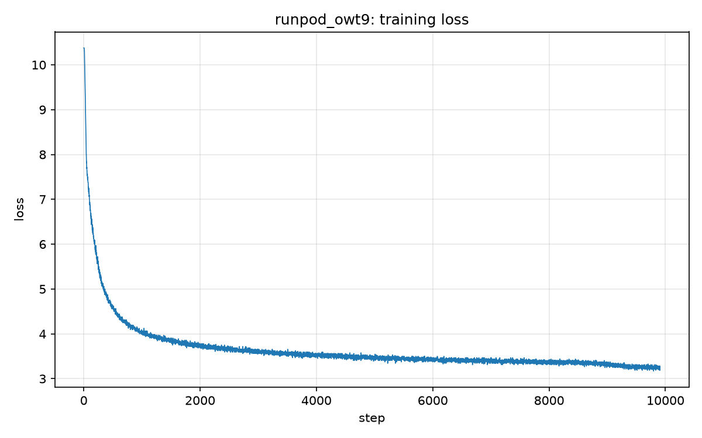

# Experiment: runpod_owt9

## Brief summary

first validation tracking

## Timing

- **Training start time:** 2026-10-24 15:27:45
- **Training end time:** 2026-10-24 16:12:45
- **Total training time:** 0h 45m 0.8s (2700.8 s)
- **Steps completed:** 9908 (step 0 to 9907)

### Per-step time

| statistic | seconds |
| --- | --- |
| mean (excluding first step) | 0.2719 |
| median | 0.2711 |
| min | 0.2605 |
| max | 5.5929 |
| first step (includes compile) | 6.5125 |

## Hyperparameters

| name | value |
| --- | --- |
| schedule | hybrid (step warmup + time decay) |
| mode | time |
| optimizer | AdamW only |
| lr_min | 0.00015 |
| lr_max | 0.0015 |
| weight_decay | 0.1 |
| batch_size | 256 |
| grad_accum_steps | 1 |
| effective_batch_size | 256 |
| max_seq | 512 |
| d_model | 1024 |
| num_heads | 16 |
| num_layers | 10 |
| d_ff | 2688 |
| vocab_size | 32000 |
| rope theta | 10000 |
| device | cuda |
| dtype | torch.bfloat16 |
| dataset | opentext |
| vocab_path | vocabulary_owt_train.pkl |
| encoded_path | encoded_owt_train.pkl |
| time_budget_seconds | 2700 |
| time_budget_minutes | 45.0 |
| Tw (warmup steps) | 500 |
| decay_sec | 385.7142857142857 |
| decay_fraction_of_budget | 0.14285714285714285 |
| validation | off |

## Full-step MFU

- **Peak TFLOPS (denominator):** 2250
- **Warmup steps discarded:** 15
- **Valid post-warmup steps:** 9893
- **Terminal print window:** 20 steps
- **FLOP model:** 4x_fwd_with_recompute (bwd window includes +1× forward recompute from activation checkpointing)

### Overall average (all valid steps)

| phase | latency_ms | TFLOPS | MFU% |
| --- | --- | --- | --- |
| Forward | 111.423 | 317.71 | 14.12% |
| Backward | 150.290 | 706.49 | 31.40% |
| Full step | 261.713 | 540.94 | 24.04% |

### Per-window averages

| window | n | fwd_ms | bwd_ms | step_ms | fwd_MFU% | bwd_MFU% | step_MFU% |
| --- | --- | --- | --- | --- | --- | --- | --- |
| 1 | 20 | 108.217 | 147.926 | 256.143 | 14.54% | 31.90% | 24.56% |
| 2 | 20 | 107.371 | 148.056 | 255.427 | 14.65% | 31.87% | 24.63% |
| 3 | 20 | 109.130 | 148.916 | 258.045 | 14.42% | 31.69% | 24.38% |
| 4 | 20 | 109.907 | 149.482 | 259.389 | 14.31% | 31.57% | 24.26% |
| 5 | 20 | 110.675 | 150.187 | 260.862 | 14.22% | 31.42% | 24.12% |
| 6 | 20 | 110.517 | 150.517 | 261.034 | 14.24% | 31.36% | 24.11% |
| 7 | 20 | 110.446 | 150.109 | 260.556 | 14.25% | 31.44% | 24.15% |
| 8 | 20 | 110.985 | 150.364 | 261.349 | 14.18% | 31.39% | 24.08% |
| 9 | 20 | 111.191 | 150.189 | 261.379 | 14.15% | 31.42% | 24.07% |
| 10 | 20 | 111.017 | 149.708 | 260.725 | 14.17% | 31.52% | 24.13% |
| 11 | 20 | 111.218 | 150.387 | 261.604 | 14.15% | 31.38% | 24.05% |
| 12 | 20 | 111.170 | 150.019 | 261.188 | 14.15% | 31.46% | 24.09% |
| 13 | 20 | 111.134 | 149.864 | 260.999 | 14.16% | 31.49% | 24.11% |
| 14 | 20 | 111.237 | 150.242 | 261.480 | 14.14% | 31.41% | 24.06% |
| 15 | 20 | 111.408 | 149.975 | 261.382 | 14.12% | 31.46% | 24.07% |
| 16 | 20 | 111.536 | 150.053 | 261.589 | 14.11% | 31.45% | 24.05% |
| 17 | 20 | 111.354 | 150.109 | 261.462 | 14.13% | 31.44% | 24.06% |
| 18 | 20 | 111.646 | 150.310 | 261.956 | 14.09% | 31.40% | 24.02% |
| 19 | 20 | 111.484 | 149.486 | 260.969 | 14.11% | 31.57% | 24.11% |
| 20 | 20 | 112.059 | 149.843 | 261.902 | 14.04% | 31.49% | 24.02% |
| 21 | 20 | 111.378 | 150.392 | 261.770 | 14.12% | 31.38% | 24.04% |
| 22 | 20 | 111.595 | 149.949 | 261.544 | 14.10% | 31.47% | 24.06% |
| 23 | 20 | 111.594 | 150.023 | 261.617 | 14.10% | 31.45% | 24.05% |
| 24 | 20 | 112.276 | 150.431 | 262.707 | 14.02% | 31.37% | 23.95% |
| 25 | 20 | 111.968 | 150.393 | 262.361 | 14.05% | 31.38% | 23.98% |
| 26 | 20 | 111.534 | 150.352 | 261.886 | 14.11% | 31.39% | 24.03% |
| 27 | 20 | 111.539 | 150.153 | 261.692 | 14.11% | 31.43% | 24.04% |
| 28 | 20 | 112.282 | 150.449 | 262.731 | 14.01% | 31.37% | 23.95% |
| 29 | 20 | 111.570 | 150.588 | 262.158 | 14.10% | 31.34% | 24.00% |
| 30 | 20 | 111.329 | 150.324 | 261.653 | 14.13% | 31.39% | 24.05% |
| 31 | 20 | 110.920 | 150.093 | 261.013 | 14.18% | 31.44% | 24.11% |
| 32 | 20 | 111.315 | 150.395 | 261.711 | 14.13% | 31.38% | 24.04% |
| 33 | 20 | 110.850 | 150.273 | 261.123 | 14.19% | 31.40% | 24.10% |
| 34 | 20 | 111.373 | 150.289 | 261.662 | 14.13% | 31.40% | 24.05% |
| 35 | 20 | 111.323 | 150.327 | 261.650 | 14.13% | 31.39% | 24.05% |
| 36 | 20 | 110.709 | 150.090 | 260.799 | 14.21% | 31.44% | 24.13% |
| 37 | 20 | 111.284 | 150.097 | 261.381 | 14.14% | 31.44% | 24.07% |
| 38 | 20 | 111.764 | 149.749 | 261.513 | 14.08% | 31.51% | 24.06% |
| 39 | 20 | 111.470 | 149.958 | 261.428 | 14.11% | 31.47% | 24.07% |
| 40 | 20 | 110.971 | 150.206 | 261.178 | 14.18% | 31.42% | 24.09% |
| 41 | 20 | 111.579 | 150.368 | 261.947 | 14.10% | 31.38% | 24.02% |
| 42 | 20 | 111.082 | 150.357 | 261.439 | 14.16% | 31.38% | 24.07% |
| 43 | 20 | 111.009 | 150.202 | 261.211 | 14.17% | 31.42% | 24.09% |
| 44 | 20 | 111.195 | 150.295 | 261.490 | 14.15% | 31.40% | 24.06% |
| 45 | 20 | 111.440 | 150.253 | 261.692 | 14.12% | 31.41% | 24.04% |
| 46 | 20 | 111.377 | 149.832 | 261.209 | 14.13% | 31.49% | 24.09% |
| 47 | 20 | 111.219 | 150.016 | 261.235 | 14.15% | 31.46% | 24.09% |
| 48 | 20 | 111.125 | 150.019 | 261.144 | 14.16% | 31.46% | 24.09% |
| 49 | 20 | 111.492 | 150.014 | 261.506 | 14.11% | 31.46% | 24.06% |
| 50 | 20 | 111.261 | 150.409 | 261.669 | 14.14% | 31.37% | 24.04% |
| 51 | 20 | 111.334 | 150.467 | 261.800 | 14.13% | 31.36% | 24.03% |
| 52 | 20 | 111.930 | 150.123 | 262.052 | 14.06% | 31.43% | 24.01% |
| 53 | 20 | 111.498 | 150.120 | 261.618 | 14.11% | 31.43% | 24.05% |
| 54 | 20 | 110.646 | 150.292 | 260.939 | 14.22% | 31.40% | 24.11% |
| 55 | 20 | 111.603 | 150.232 | 261.835 | 14.10% | 31.41% | 24.03% |
| 56 | 20 | 111.060 | 150.371 | 261.432 | 14.17% | 31.38% | 24.07% |
| 57 | 20 | 111.408 | 150.263 | 261.671 | 14.12% | 31.41% | 24.05% |
| 58 | 20 | 111.741 | 150.638 | 262.378 | 14.08% | 31.33% | 23.98% |
| 59 | 20 | 111.581 | 150.132 | 261.713 | 14.10% | 31.43% | 24.04% |
| 60 | 20 | 111.516 | 150.220 | 261.736 | 14.11% | 31.41% | 24.04% |
| 61 | 20 | 111.395 | 150.318 | 261.713 | 14.12% | 31.39% | 24.04% |
| 62 | 20 | 111.611 | 150.239 | 261.850 | 14.10% | 31.41% | 24.03% |
| 63 | 20 | 110.978 | 150.205 | 261.184 | 14.18% | 31.42% | 24.09% |
| 64 | 20 | 111.600 | 150.411 | 262.012 | 14.10% | 31.37% | 24.01% |
| 65 | 20 | 111.388 | 150.114 | 261.502 | 14.12% | 31.44% | 24.06% |
| 66 | 20 | 111.096 | 150.356 | 261.452 | 14.16% | 31.38% | 24.07% |
| 67 | 20 | 111.294 | 150.323 | 261.617 | 14.14% | 31.39% | 24.05% |
| 68 | 20 | 111.034 | 150.565 | 261.599 | 14.17% | 31.34% | 24.05% |
| 69 | 20 | 111.802 | 150.107 | 261.910 | 14.07% | 31.44% | 24.02% |
| 70 | 20 | 111.726 | 149.915 | 261.641 | 14.08% | 31.48% | 24.05% |
| 71 | 20 | 111.786 | 150.237 | 262.023 | 14.08% | 31.41% | 24.01% |
| 72 | 20 | 111.102 | 150.173 | 261.275 | 14.16% | 31.42% | 24.08% |
| 73 | 20 | 110.827 | 150.060 | 260.888 | 14.19% | 31.45% | 24.12% |
| 74 | 20 | 111.022 | 150.248 | 261.270 | 14.17% | 31.41% | 24.08% |
| 75 | 20 | 111.030 | 150.362 | 261.391 | 14.17% | 31.39% | 24.07% |
| 76 | 20 | 111.470 | 150.276 | 261.746 | 14.11% | 31.40% | 24.04% |
| 77 | 20 | 111.699 | 150.501 | 262.200 | 14.09% | 31.36% | 24.00% |
| 78 | 20 | 111.345 | 149.995 | 261.340 | 14.13% | 31.46% | 24.08% |
| 79 | 20 | 111.720 | 150.018 | 261.738 | 14.08% | 31.46% | 24.04% |
| 80 | 20 | 111.682 | 150.124 | 261.806 | 14.09% | 31.43% | 24.03% |
| 81 | 20 | 111.334 | 150.376 | 261.710 | 14.13% | 31.38% | 24.04% |
| 82 | 20 | 111.141 | 150.549 | 261.690 | 14.15% | 31.34% | 24.04% |
| 83 | 20 | 111.517 | 150.755 | 262.272 | 14.11% | 31.30% | 23.99% |
| 84 | 20 | 111.212 | 149.996 | 261.208 | 14.15% | 31.46% | 24.09% |
| 85 | 20 | 111.504 | 150.470 | 261.974 | 14.11% | 31.36% | 24.02% |
| 86 | 20 | 112.129 | 150.186 | 262.315 | 14.03% | 31.42% | 23.99% |
| 87 | 20 | 111.063 | 150.609 | 261.672 | 14.17% | 31.33% | 24.05% |
| 88 | 20 | 111.789 | 150.531 | 262.320 | 14.07% | 31.35% | 23.99% |
| 89 | 20 | 111.400 | 150.192 | 261.592 | 14.12% | 31.42% | 24.05% |
| 90 | 20 | 111.328 | 150.034 | 261.362 | 14.13% | 31.45% | 24.07% |
| 91 | 20 | 111.569 | 150.390 | 261.959 | 14.10% | 31.38% | 24.02% |
| 92 | 20 | 111.319 | 150.015 | 261.334 | 14.13% | 31.46% | 24.08% |
| 93 | 20 | 111.210 | 150.334 | 261.543 | 14.15% | 31.39% | 24.06% |
| 94 | 20 | 111.432 | 150.220 | 261.652 | 14.12% | 31.41% | 24.05% |
| 95 | 20 | 111.327 | 150.391 | 261.718 | 14.13% | 31.38% | 24.04% |
| 96 | 20 | 111.298 | 150.479 | 261.777 | 14.14% | 31.36% | 24.04% |
| 97 | 20 | 111.542 | 149.997 | 261.539 | 14.10% | 31.46% | 24.06% |
| 98 | 20 | 110.925 | 150.478 | 261.403 | 14.18% | 31.36% | 24.07% |
| 99 | 20 | 111.222 | 150.761 | 261.984 | 14.15% | 31.30% | 24.02% |
| 100 | 20 | 111.691 | 149.906 | 261.597 | 14.09% | 31.48% | 24.05% |
| 101 | 20 | 111.724 | 150.183 | 261.908 | 14.08% | 31.42% | 24.02% |
| 102 | 20 | 110.885 | 150.085 | 260.970 | 14.19% | 31.44% | 24.11% |
| 103 | 20 | 110.989 | 150.383 | 261.372 | 14.17% | 31.38% | 24.07% |
| 104 | 20 | 111.247 | 150.026 | 261.272 | 14.14% | 31.45% | 24.08% |
| 105 | 20 | 110.955 | 150.069 | 261.024 | 14.18% | 31.44% | 24.10% |
| 106 | 20 | 111.255 | 150.130 | 261.385 | 14.14% | 31.43% | 24.07% |
| 107 | 20 | 110.764 | 150.013 | 260.778 | 14.20% | 31.46% | 24.13% |
| 108 | 20 | 111.294 | 150.318 | 261.611 | 14.14% | 31.39% | 24.05% |
| 109 | 20 | 111.653 | 150.312 | 261.966 | 14.09% | 31.40% | 24.02% |
| 110 | 20 | 111.315 | 150.213 | 261.528 | 14.13% | 31.42% | 24.06% |
| 111 | 20 | 111.445 | 150.498 | 261.943 | 14.12% | 31.36% | 24.02% |
| 112 | 20 | 111.762 | 150.248 | 262.009 | 14.08% | 31.41% | 24.01% |
| 113 | 20 | 111.663 | 150.285 | 261.948 | 14.09% | 31.40% | 24.02% |
| 114 | 20 | 111.306 | 149.993 | 261.299 | 14.13% | 31.46% | 24.08% |
| 115 | 20 | 111.391 | 149.948 | 261.339 | 14.12% | 31.47% | 24.08% |
| 116 | 20 | 111.264 | 150.171 | 261.435 | 14.14% | 31.42% | 24.07% |
| 117 | 20 | 111.610 | 149.775 | 261.385 | 14.10% | 31.51% | 24.07% |
| 118 | 20 | 111.522 | 150.329 | 261.851 | 14.11% | 31.39% | 24.03% |
| 119 | 20 | 111.031 | 150.125 | 261.156 | 14.17% | 31.44% | 24.09% |
| 120 | 20 | 111.367 | 150.223 | 261.590 | 14.13% | 31.41% | 24.05% |
| 121 | 20 | 110.956 | 150.456 | 261.412 | 14.18% | 31.36% | 24.07% |
| 122 | 20 | 111.235 | 150.472 | 261.707 | 14.14% | 31.36% | 24.04% |
| 123 | 20 | 111.186 | 150.662 | 261.848 | 14.15% | 31.32% | 24.03% |
| 124 | 20 | 111.138 | 149.965 | 261.103 | 14.16% | 31.47% | 24.10% |
| 125 | 20 | 110.984 | 150.094 | 261.078 | 14.17% | 31.44% | 24.10% |
| 126 | 20 | 112.193 | 150.445 | 262.639 | 14.03% | 31.37% | 23.96% |
| 127 | 20 | 111.419 | 149.885 | 261.303 | 14.12% | 31.48% | 24.08% |
| 128 | 20 | 110.916 | 150.395 | 261.311 | 14.18% | 31.38% | 24.08% |
| 129 | 20 | 111.773 | 150.014 | 261.787 | 14.08% | 31.46% | 24.04% |
| 130 | 20 | 112.251 | 150.062 | 262.313 | 14.02% | 31.45% | 23.99% |
| 131 | 20 | 111.023 | 149.731 | 260.754 | 14.17% | 31.52% | 24.13% |
| 132 | 20 | 111.518 | 150.288 | 261.806 | 14.11% | 31.40% | 24.03% |
| 133 | 20 | 112.127 | 150.120 | 262.247 | 14.03% | 31.44% | 23.99% |
| 134 | 20 | 111.318 | 150.358 | 261.676 | 14.13% | 31.38% | 24.05% |
| 135 | 20 | 111.792 | 150.304 | 262.096 | 14.07% | 31.40% | 24.01% |
| 136 | 20 | 111.506 | 150.081 | 261.587 | 14.11% | 31.44% | 24.05% |
| 137 | 20 | 111.335 | 150.295 | 261.630 | 14.13% | 31.40% | 24.05% |
| 138 | 20 | 111.984 | 150.269 | 262.253 | 14.05% | 31.40% | 23.99% |
| 139 | 20 | 111.724 | 150.465 | 262.188 | 14.08% | 31.36% | 24.00% |
| 140 | 20 | 111.625 | 150.014 | 261.639 | 14.10% | 31.46% | 24.05% |
| 141 | 20 | 111.507 | 150.260 | 261.767 | 14.11% | 31.41% | 24.04% |
| 142 | 20 | 110.983 | 150.016 | 260.999 | 14.17% | 31.46% | 24.11% |
| 143 | 20 | 111.749 | 150.085 | 261.834 | 14.08% | 31.44% | 24.03% |
| 144 | 20 | 110.844 | 150.506 | 261.350 | 14.19% | 31.35% | 24.08% |
| 145 | 20 | 111.624 | 150.361 | 261.985 | 14.09% | 31.38% | 24.02% |
| 146 | 20 | 111.560 | 150.503 | 262.063 | 14.10% | 31.36% | 24.01% |
| 147 | 20 | 111.487 | 149.974 | 261.461 | 14.11% | 31.46% | 24.06% |
| 148 | 20 | 111.496 | 149.965 | 261.461 | 14.11% | 31.47% | 24.06% |
| 149 | 20 | 111.276 | 150.104 | 261.380 | 14.14% | 31.44% | 24.07% |
| 150 | 20 | 111.094 | 150.072 | 261.166 | 14.16% | 31.44% | 24.09% |
| 151 | 20 | 111.056 | 150.139 | 261.196 | 14.17% | 31.43% | 24.09% |
| 152 | 20 | 110.745 | 150.710 | 261.454 | 14.21% | 31.31% | 24.07% |
| 153 | 20 | 111.915 | 149.785 | 261.700 | 14.06% | 31.51% | 24.04% |
| 154 | 20 | 111.406 | 150.135 | 261.540 | 14.12% | 31.43% | 24.06% |
| 155 | 20 | 111.195 | 150.037 | 261.233 | 14.15% | 31.45% | 24.09% |
| 156 | 20 | 111.219 | 149.868 | 261.087 | 14.15% | 31.49% | 24.10% |
| 157 | 20 | 111.580 | 150.301 | 261.881 | 14.11% | 31.40% | 24.03% |
| 158 | 20 | 111.672 | 150.059 | 261.731 | 14.09% | 31.45% | 24.04% |
| 159 | 20 | 111.258 | 150.491 | 261.749 | 14.14% | 31.36% | 24.04% |
| 160 | 20 | 111.647 | 150.215 | 261.862 | 14.09% | 31.42% | 24.03% |
| 161 | 20 | 111.392 | 150.003 | 261.394 | 14.12% | 31.46% | 24.07% |
| 162 | 20 | 111.438 | 150.550 | 261.987 | 14.12% | 31.35% | 24.02% |
| 163 | 20 | 111.707 | 150.068 | 261.776 | 14.08% | 31.45% | 24.04% |
| 164 | 20 | 111.303 | 150.510 | 261.813 | 14.14% | 31.35% | 24.03% |
| 165 | 20 | 111.054 | 150.475 | 261.529 | 14.17% | 31.36% | 24.06% |
| 166 | 20 | 111.609 | 150.275 | 261.885 | 14.10% | 31.40% | 24.03% |
| 167 | 20 | 111.489 | 150.221 | 261.711 | 14.11% | 31.41% | 24.04% |
| 168 | 20 | 111.007 | 150.345 | 261.352 | 14.17% | 31.39% | 24.08% |
| 169 | 20 | 111.621 | 149.998 | 261.619 | 14.10% | 31.46% | 24.05% |
| 170 | 20 | 110.753 | 150.310 | 261.062 | 14.20% | 31.39% | 24.10% |
| 171 | 20 | 111.329 | 150.136 | 261.464 | 14.13% | 31.43% | 24.06% |
| 172 | 20 | 111.592 | 150.421 | 262.013 | 14.10% | 31.37% | 24.01% |
| 173 | 20 | 111.631 | 149.784 | 261.415 | 14.09% | 31.50% | 24.07% |
| 174 | 20 | 111.435 | 150.689 | 262.124 | 14.12% | 31.32% | 24.00% |
| 175 | 20 | 111.532 | 150.163 | 261.695 | 14.11% | 31.43% | 24.04% |
| 176 | 20 | 111.812 | 150.168 | 261.980 | 14.07% | 31.42% | 24.02% |
| 177 | 20 | 110.899 | 150.302 | 261.201 | 14.19% | 31.40% | 24.09% |
| 178 | 20 | 111.427 | 150.282 | 261.709 | 14.12% | 31.40% | 24.04% |
| 179 | 20 | 111.682 | 150.012 | 261.694 | 14.09% | 31.46% | 24.04% |
| 180 | 20 | 111.720 | 150.451 | 262.171 | 14.09% | 31.37% | 24.00% |
| 181 | 20 | 111.109 | 150.094 | 261.203 | 14.16% | 31.44% | 24.09% |
| 182 | 20 | 111.570 | 150.360 | 261.930 | 14.10% | 31.38% | 24.02% |
| 183 | 20 | 110.761 | 150.340 | 261.101 | 14.20% | 31.39% | 24.10% |
| 184 | 20 | 111.629 | 149.685 | 261.315 | 14.09% | 31.53% | 24.08% |
| 185 | 20 | 110.926 | 150.756 | 261.682 | 14.18% | 31.30% | 24.04% |
| 186 | 20 | 111.758 | 150.650 | 262.407 | 14.08% | 31.33% | 23.98% |
| 187 | 20 | 111.887 | 150.764 | 262.651 | 14.06% | 31.30% | 23.96% |
| 188 | 20 | 111.424 | 150.122 | 261.546 | 14.12% | 31.43% | 24.06% |
| 189 | 20 | 111.010 | 150.731 | 261.741 | 14.17% | 31.31% | 24.04% |
| 190 | 20 | 111.710 | 150.272 | 261.982 | 14.09% | 31.40% | 24.02% |
| 191 | 20 | 111.228 | 150.619 | 261.847 | 14.14% | 31.33% | 24.03% |
| 192 | 20 | 111.882 | 150.261 | 262.143 | 14.06% | 31.41% | 24.00% |
| 193 | 20 | 111.720 | 150.137 | 261.857 | 14.08% | 31.43% | 24.03% |
| 194 | 20 | 111.848 | 150.035 | 261.883 | 14.07% | 31.45% | 24.03% |
| 195 | 20 | 111.412 | 149.841 | 261.253 | 14.12% | 31.49% | 24.08% |
| 196 | 20 | 111.169 | 150.129 | 261.299 | 14.15% | 31.43% | 24.08% |
| 197 | 20 | 111.231 | 150.226 | 261.457 | 14.14% | 31.41% | 24.06% |
| 198 | 20 | 111.402 | 150.157 | 261.559 | 14.12% | 31.43% | 24.06% |
| 199 | 20 | 112.051 | 150.108 | 262.158 | 14.04% | 31.44% | 24.00% |
| 200 | 20 | 111.582 | 149.909 | 261.492 | 14.10% | 31.48% | 24.06% |
| 201 | 20 | 111.121 | 150.415 | 261.536 | 14.16% | 31.37% | 24.06% |
| 202 | 20 | 111.336 | 150.326 | 261.663 | 14.13% | 31.39% | 24.05% |
| 203 | 20 | 111.543 | 150.204 | 261.746 | 14.10% | 31.42% | 24.04% |
| 204 | 20 | 111.638 | 150.342 | 261.980 | 14.09% | 31.39% | 24.02% |
| 205 | 20 | 111.300 | 150.397 | 261.696 | 14.14% | 31.38% | 24.04% |
| 206 | 20 | 111.208 | 150.444 | 261.651 | 14.15% | 31.37% | 24.05% |
| 207 | 20 | 111.609 | 150.334 | 261.943 | 14.10% | 31.39% | 24.02% |
| 208 | 20 | 111.703 | 150.051 | 261.754 | 14.09% | 31.45% | 24.04% |
| 209 | 20 | 111.474 | 150.180 | 261.654 | 14.11% | 31.42% | 24.05% |
| 210 | 20 | 111.315 | 150.593 | 261.908 | 14.13% | 31.34% | 24.02% |
| 211 | 20 | 111.430 | 150.453 | 261.883 | 14.12% | 31.37% | 24.03% |
| 212 | 20 | 111.372 | 150.287 | 261.659 | 14.13% | 31.40% | 24.05% |
| 213 | 20 | 111.262 | 150.080 | 261.342 | 14.14% | 31.44% | 24.08% |
| 214 | 20 | 111.613 | 150.585 | 262.198 | 14.10% | 31.34% | 24.00% |
| 215 | 20 | 111.756 | 150.387 | 262.143 | 14.08% | 31.38% | 24.00% |
| 216 | 20 | 112.302 | 150.333 | 262.635 | 14.01% | 31.39% | 23.96% |
| 217 | 20 | 111.316 | 150.594 | 261.910 | 14.13% | 31.34% | 24.02% |
| 218 | 20 | 112.141 | 150.590 | 262.731 | 14.03% | 31.34% | 23.95% |
| 219 | 20 | 111.371 | 150.111 | 261.482 | 14.13% | 31.44% | 24.06% |
| 220 | 20 | 111.134 | 150.607 | 261.741 | 14.16% | 31.33% | 24.04% |
| 221 | 20 | 111.113 | 150.018 | 261.131 | 14.16% | 31.46% | 24.10% |
| 222 | 20 | 111.279 | 149.953 | 261.232 | 14.14% | 31.47% | 24.09% |
| 223 | 20 | 111.961 | 150.227 | 262.189 | 14.05% | 31.41% | 24.00% |
| 224 | 20 | 110.850 | 150.560 | 261.410 | 14.19% | 31.34% | 24.07% |
| 225 | 20 | 111.150 | 149.958 | 261.109 | 14.16% | 31.47% | 24.10% |
| 226 | 20 | 111.550 | 150.377 | 261.927 | 14.10% | 31.38% | 24.02% |
| 227 | 20 | 111.407 | 150.424 | 261.831 | 14.12% | 31.37% | 24.03% |
| 228 | 20 | 111.836 | 150.414 | 262.251 | 14.07% | 31.37% | 23.99% |
| 229 | 20 | 111.551 | 150.595 | 262.145 | 14.11% | 31.34% | 24.00% |
| 230 | 20 | 111.498 | 150.395 | 261.893 | 14.11% | 31.38% | 24.02% |
| 231 | 20 | 111.687 | 150.311 | 261.998 | 14.09% | 31.39% | 24.01% |
| 232 | 20 | 111.724 | 150.530 | 262.254 | 14.08% | 31.35% | 23.99% |
| 233 | 20 | 111.665 | 150.647 | 262.312 | 14.09% | 31.33% | 23.99% |
| 234 | 20 | 111.624 | 150.443 | 262.067 | 14.09% | 31.37% | 24.01% |
| 235 | 20 | 111.586 | 150.273 | 261.859 | 14.10% | 31.40% | 24.03% |
| 236 | 20 | 111.014 | 150.362 | 261.376 | 14.17% | 31.38% | 24.07% |
| 237 | 20 | 110.645 | 150.232 | 260.878 | 14.22% | 31.41% | 24.12% |
| 238 | 20 | 111.520 | 150.245 | 261.764 | 14.11% | 31.41% | 24.04% |
| 239 | 20 | 111.915 | 150.936 | 262.851 | 14.06% | 31.27% | 23.94% |
| 240 | 20 | 111.884 | 150.418 | 262.302 | 14.06% | 31.37% | 23.99% |
| 241 | 20 | 111.858 | 150.310 | 262.169 | 14.06% | 31.40% | 24.00% |
| 242 | 20 | 111.419 | 150.292 | 261.711 | 14.12% | 31.40% | 24.04% |
| 243 | 20 | 111.208 | 150.192 | 261.400 | 14.15% | 31.42% | 24.07% |
| 244 | 20 | 111.578 | 150.238 | 261.816 | 14.10% | 31.41% | 24.03% |
| 245 | 20 | 111.381 | 150.315 | 261.695 | 14.13% | 31.39% | 24.04% |
| 246 | 20 | 111.272 | 150.313 | 261.585 | 14.14% | 31.40% | 24.05% |
| 247 | 20 | 111.462 | 151.105 | 262.566 | 14.12% | 31.23% | 23.96% |
| 248 | 20 | 111.316 | 150.067 | 261.383 | 14.13% | 31.45% | 24.07% |
| 249 | 20 | 110.928 | 149.679 | 260.607 | 14.18% | 31.53% | 24.14% |
| 250 | 20 | 110.527 | 150.157 | 260.684 | 14.23% | 31.43% | 24.14% |
| 251 | 20 | 111.088 | 150.140 | 261.228 | 14.16% | 31.43% | 24.09% |
| 252 | 20 | 111.403 | 149.955 | 261.358 | 14.12% | 31.47% | 24.07% |
| 253 | 20 | 111.182 | 150.234 | 261.416 | 14.15% | 31.41% | 24.07% |
| 254 | 20 | 111.372 | 150.414 | 261.786 | 14.13% | 31.37% | 24.03% |
| 255 | 20 | 111.954 | 150.148 | 262.102 | 14.06% | 31.43% | 24.01% |
| 256 | 20 | 111.959 | 150.725 | 262.684 | 14.05% | 31.31% | 23.95% |
| 257 | 20 | 111.829 | 150.822 | 262.651 | 14.07% | 31.29% | 23.96% |
| 258 | 20 | 111.169 | 150.276 | 261.445 | 14.15% | 31.40% | 24.07% |
| 259 | 20 | 111.080 | 150.261 | 261.341 | 14.16% | 31.41% | 24.08% |
| 260 | 20 | 111.405 | 150.748 | 262.153 | 14.12% | 31.30% | 24.00% |
| 261 | 20 | 111.205 | 150.530 | 261.734 | 14.15% | 31.35% | 24.04% |
| 262 | 20 | 111.802 | 150.441 | 262.243 | 14.07% | 31.37% | 23.99% |
| 263 | 20 | 111.369 | 150.509 | 261.878 | 14.13% | 31.35% | 24.03% |
| 264 | 20 | 112.144 | 150.316 | 262.460 | 14.03% | 31.39% | 23.97% |
| 265 | 20 | 111.229 | 150.587 | 261.816 | 14.14% | 31.34% | 24.03% |
| 266 | 20 | 111.380 | 150.419 | 261.799 | 14.12% | 31.37% | 24.03% |
| 267 | 20 | 111.482 | 150.320 | 261.803 | 14.11% | 31.39% | 24.03% |
| 268 | 20 | 111.670 | 150.189 | 261.859 | 14.09% | 31.42% | 24.03% |
| 269 | 20 | 111.405 | 149.996 | 261.401 | 14.12% | 31.46% | 24.07% |
| 270 | 20 | 112.378 | 150.422 | 262.801 | 14.00% | 31.37% | 23.94% |
| 271 | 20 | 111.123 | 150.537 | 261.660 | 14.16% | 31.35% | 24.05% |
| 272 | 20 | 111.340 | 150.758 | 262.098 | 14.13% | 31.30% | 24.01% |
| 273 | 20 | 111.347 | 150.262 | 261.609 | 14.13% | 31.40% | 24.05% |
| 274 | 20 | 111.163 | 150.420 | 261.582 | 14.15% | 31.37% | 24.05% |
| 275 | 20 | 110.829 | 150.211 | 261.040 | 14.19% | 31.42% | 24.10% |
| 276 | 20 | 111.118 | 150.377 | 261.495 | 14.16% | 31.38% | 24.06% |
| 277 | 20 | 112.069 | 150.343 | 262.412 | 14.04% | 31.39% | 23.98% |
| 278 | 20 | 111.448 | 150.670 | 262.118 | 14.12% | 31.32% | 24.00% |
| 279 | 20 | 111.790 | 150.236 | 262.026 | 14.07% | 31.41% | 24.01% |
| 280 | 20 | 111.604 | 150.276 | 261.880 | 14.10% | 31.40% | 24.03% |
| 281 | 20 | 111.078 | 150.704 | 261.782 | 14.16% | 31.31% | 24.03% |
| 282 | 20 | 111.232 | 150.183 | 261.415 | 14.14% | 31.42% | 24.07% |
| 283 | 20 | 111.494 | 150.026 | 261.519 | 14.11% | 31.45% | 24.06% |
| 284 | 20 | 111.342 | 149.853 | 261.194 | 14.13% | 31.49% | 24.09% |
| 285 | 20 | 111.166 | 150.662 | 261.828 | 14.15% | 31.32% | 24.03% |
| 286 | 20 | 111.092 | 149.890 | 260.982 | 14.16% | 31.48% | 24.11% |
| 287 | 20 | 111.540 | 150.267 | 261.806 | 14.10% | 31.40% | 24.03% |
| 288 | 20 | 111.399 | 149.884 | 261.283 | 14.12% | 31.48% | 24.08% |
| 289 | 20 | 110.999 | 149.910 | 260.909 | 14.17% | 31.48% | 24.12% |
| 290 | 20 | 111.279 | 149.809 | 261.088 | 14.14% | 31.50% | 24.10% |
| 291 | 20 | 111.442 | 150.264 | 261.706 | 14.12% | 31.40% | 24.04% |
| 292 | 20 | 111.241 | 150.819 | 262.059 | 14.14% | 31.29% | 24.01% |
| 293 | 20 | 112.023 | 150.515 | 262.538 | 14.04% | 31.35% | 23.97% |
| 294 | 20 | 111.414 | 150.295 | 261.709 | 14.12% | 31.40% | 24.04% |
| 295 | 20 | 110.956 | 150.399 | 261.355 | 14.18% | 31.38% | 24.07% |
| 296 | 20 | 111.817 | 150.681 | 262.497 | 14.07% | 31.32% | 23.97% |
| 297 | 20 | 110.690 | 150.330 | 261.020 | 14.21% | 31.39% | 24.11% |
| 298 | 20 | 112.269 | 150.215 | 262.483 | 14.02% | 31.41% | 23.97% |
| 299 | 20 | 112.157 | 150.663 | 262.820 | 14.03% | 31.32% | 23.94% |
| 300 | 20 | 111.180 | 150.309 | 261.489 | 14.15% | 31.40% | 24.06% |
| 301 | 20 | 111.432 | 150.277 | 261.709 | 14.12% | 31.40% | 24.04% |
| 302 | 20 | 111.685 | 150.501 | 262.187 | 14.09% | 31.36% | 24.00% |
| 303 | 20 | 111.100 | 150.340 | 261.440 | 14.16% | 31.39% | 24.07% |
| 304 | 20 | 112.232 | 150.837 | 263.069 | 14.02% | 31.29% | 23.92% |
| 305 | 20 | 111.972 | 150.623 | 262.594 | 14.05% | 31.33% | 23.96% |
| 306 | 20 | 112.057 | 150.470 | 262.527 | 14.04% | 31.36% | 23.97% |
| 307 | 20 | 111.414 | 150.307 | 261.721 | 14.12% | 31.39% | 24.04% |
| 308 | 20 | 111.756 | 150.348 | 262.104 | 14.08% | 31.39% | 24.01% |
| 309 | 20 | 112.151 | 150.952 | 263.103 | 14.03% | 31.26% | 23.92% |
| 310 | 20 | 111.665 | 150.395 | 262.059 | 14.09% | 31.38% | 24.01% |
| 311 | 20 | 111.962 | 150.135 | 262.097 | 14.05% | 31.43% | 24.01% |
| 312 | 20 | 111.953 | 150.520 | 262.473 | 14.05% | 31.35% | 23.97% |
| 313 | 20 | 111.320 | 150.339 | 261.658 | 14.13% | 31.39% | 24.05% |
| 314 | 20 | 111.110 | 150.764 | 261.873 | 14.16% | 31.30% | 24.03% |
| 315 | 20 | 111.804 | 150.087 | 261.891 | 14.07% | 31.44% | 24.03% |
| 316 | 20 | 111.418 | 150.478 | 261.897 | 14.12% | 31.36% | 24.02% |
| 317 | 20 | 111.161 | 150.503 | 261.664 | 14.15% | 31.35% | 24.05% |
| 318 | 20 | 110.805 | 150.406 | 261.211 | 14.20% | 31.38% | 24.09% |
| 319 | 20 | 111.588 | 150.441 | 262.029 | 14.10% | 31.37% | 24.01% |
| 320 | 20 | 111.240 | 150.144 | 261.384 | 14.14% | 31.43% | 24.07% |
| 321 | 20 | 111.380 | 150.533 | 261.913 | 14.12% | 31.35% | 24.02% |
| 322 | 20 | 111.798 | 150.147 | 261.945 | 14.08% | 31.43% | 24.02% |
| 323 | 20 | 111.334 | 149.789 | 261.123 | 14.13% | 31.50% | 24.10% |
| 324 | 20 | 111.274 | 150.189 | 261.463 | 14.14% | 31.42% | 24.06% |
| 325 | 20 | 111.753 | 150.398 | 262.151 | 14.08% | 31.38% | 24.00% |
| 326 | 20 | 111.406 | 150.278 | 261.684 | 14.12% | 31.40% | 24.04% |
| 327 | 20 | 111.312 | 150.579 | 261.892 | 14.13% | 31.34% | 24.02% |
| 328 | 20 | 112.199 | 150.111 | 262.310 | 14.02% | 31.44% | 23.99% |
| 329 | 20 | 110.844 | 150.054 | 260.898 | 14.19% | 31.45% | 24.12% |
| 330 | 20 | 111.427 | 150.109 | 261.536 | 14.12% | 31.44% | 24.06% |
| 331 | 20 | 111.533 | 150.180 | 261.714 | 14.11% | 31.42% | 24.04% |
| 332 | 20 | 110.979 | 150.241 | 261.220 | 14.18% | 31.41% | 24.09% |
| 333 | 20 | 111.349 | 150.555 | 261.904 | 14.13% | 31.35% | 24.02% |
| 334 | 20 | 111.319 | 150.423 | 261.742 | 14.13% | 31.37% | 24.04% |
| 335 | 20 | 111.196 | 150.525 | 261.721 | 14.15% | 31.35% | 24.04% |
| 336 | 20 | 111.067 | 150.786 | 261.853 | 14.17% | 31.30% | 24.03% |
| 337 | 20 | 111.449 | 150.510 | 261.959 | 14.12% | 31.35% | 24.02% |
| 338 | 20 | 110.954 | 150.388 | 261.342 | 14.18% | 31.38% | 24.08% |
| 339 | 20 | 111.966 | 150.382 | 262.347 | 14.05% | 31.38% | 23.98% |
| 340 | 20 | 111.537 | 150.159 | 261.696 | 14.11% | 31.43% | 24.04% |
| 341 | 20 | 111.601 | 150.538 | 262.139 | 14.10% | 31.35% | 24.00% |
| 342 | 20 | 111.515 | 150.334 | 261.850 | 14.11% | 31.39% | 24.03% |
| 343 | 20 | 111.369 | 150.569 | 261.939 | 14.13% | 31.34% | 24.02% |
| 344 | 20 | 111.134 | 150.391 | 261.526 | 14.16% | 31.38% | 24.06% |
| 345 | 20 | 110.968 | 150.317 | 261.285 | 14.18% | 31.39% | 24.08% |
| 346 | 20 | 111.617 | 150.444 | 262.061 | 14.09% | 31.37% | 24.01% |
| 347 | 20 | 111.018 | 150.507 | 261.525 | 14.17% | 31.35% | 24.06% |
| 348 | 20 | 111.557 | 150.310 | 261.868 | 14.10% | 31.40% | 24.03% |
| 349 | 20 | 112.018 | 149.966 | 261.984 | 14.05% | 31.47% | 24.02% |
| 350 | 20 | 111.426 | 150.239 | 261.665 | 14.12% | 31.41% | 24.05% |
| 351 | 20 | 111.404 | 150.363 | 261.767 | 14.12% | 31.38% | 24.04% |
| 352 | 20 | 111.894 | 150.679 | 262.574 | 14.06% | 31.32% | 23.96% |
| 353 | 20 | 111.150 | 150.341 | 261.491 | 14.15% | 31.39% | 24.06% |
| 354 | 20 | 111.354 | 150.397 | 261.752 | 14.13% | 31.38% | 24.04% |
| 355 | 20 | 112.083 | 150.823 | 262.906 | 14.04% | 31.29% | 23.93% |
| 356 | 20 | 111.993 | 150.484 | 262.477 | 14.05% | 31.36% | 23.97% |
| 357 | 20 | 110.881 | 150.271 | 261.153 | 14.19% | 31.40% | 24.09% |
| 358 | 20 | 111.133 | 150.365 | 261.498 | 14.16% | 31.38% | 24.06% |
| 359 | 20 | 111.585 | 150.527 | 262.112 | 14.10% | 31.35% | 24.01% |
| 360 | 20 | 111.421 | 150.770 | 262.191 | 14.12% | 31.30% | 24.00% |
| 361 | 20 | 111.875 | 150.348 | 262.222 | 14.06% | 31.39% | 24.00% |
| 362 | 20 | 111.438 | 150.077 | 261.515 | 14.12% | 31.44% | 24.06% |
| 363 | 20 | 111.921 | 150.431 | 262.352 | 14.06% | 31.37% | 23.98% |
| 364 | 20 | 111.738 | 150.295 | 262.033 | 14.08% | 31.40% | 24.01% |
| 365 | 20 | 111.353 | 151.064 | 262.417 | 14.13% | 31.24% | 23.98% |
| 366 | 20 | 111.975 | 150.161 | 262.136 | 14.05% | 31.43% | 24.00% |
| 367 | 20 | 111.460 | 149.971 | 261.430 | 14.12% | 31.47% | 24.07% |
| 368 | 20 | 111.603 | 149.683 | 261.286 | 14.10% | 31.53% | 24.08% |
| 369 | 20 | 111.558 | 150.626 | 262.184 | 14.10% | 31.33% | 24.00% |
| 370 | 20 | 110.864 | 150.197 | 261.061 | 14.19% | 31.42% | 24.10% |
| 371 | 20 | 111.330 | 150.610 | 261.940 | 14.13% | 31.33% | 24.02% |
| 372 | 20 | 111.253 | 149.981 | 261.234 | 14.14% | 31.46% | 24.09% |
| 373 | 20 | 112.060 | 150.082 | 262.143 | 14.04% | 31.44% | 24.00% |
| 374 | 20 | 110.988 | 150.175 | 261.163 | 14.18% | 31.42% | 24.09% |
| 375 | 20 | 111.632 | 150.748 | 262.381 | 14.10% | 31.30% | 23.98% |
| 376 | 20 | 111.289 | 149.773 | 261.062 | 14.14% | 31.51% | 24.10% |
| 377 | 20 | 111.681 | 150.521 | 262.203 | 14.09% | 31.35% | 24.00% |
| 378 | 20 | 111.947 | 149.935 | 261.882 | 14.05% | 31.47% | 24.03% |
| 379 | 20 | 111.409 | 150.793 | 262.202 | 14.12% | 31.30% | 24.00% |
| 380 | 20 | 111.721 | 150.303 | 262.024 | 14.08% | 31.40% | 24.01% |
| 381 | 20 | 111.898 | 150.382 | 262.280 | 14.06% | 31.38% | 23.99% |
| 382 | 20 | 111.930 | 150.362 | 262.293 | 14.06% | 31.38% | 23.99% |
| 383 | 20 | 111.008 | 150.631 | 261.639 | 14.17% | 31.33% | 24.05% |
| 384 | 20 | 111.321 | 150.679 | 262.001 | 14.13% | 31.32% | 24.02% |
| 385 | 20 | 111.176 | 150.740 | 261.916 | 14.15% | 31.31% | 24.02% |
| 386 | 20 | 111.281 | 150.489 | 261.770 | 14.14% | 31.36% | 24.04% |
| 387 | 20 | 110.995 | 151.028 | 262.022 | 14.17% | 31.25% | 24.01% |
| 388 | 20 | 110.988 | 150.673 | 261.662 | 14.17% | 31.32% | 24.05% |
| 389 | 20 | 111.548 | 150.266 | 261.813 | 14.11% | 31.40% | 24.03% |
| 390 | 20 | 111.112 | 150.172 | 261.284 | 14.16% | 31.42% | 24.08% |
| 391 | 20 | 110.785 | 150.340 | 261.125 | 14.20% | 31.39% | 24.10% |
| 392 | 20 | 111.127 | 150.517 | 261.644 | 14.16% | 31.35% | 24.05% |
| 393 | 20 | 111.452 | 150.127 | 261.579 | 14.12% | 31.43% | 24.05% |
| 394 | 20 | 111.518 | 150.260 | 261.778 | 14.11% | 31.41% | 24.04% |
| 395 | 20 | 111.405 | 150.609 | 262.014 | 14.12% | 31.33% | 24.01% |
| 396 | 20 | 111.138 | 150.385 | 261.523 | 14.15% | 31.38% | 24.06% |
| 397 | 20 | 111.154 | 150.257 | 261.411 | 14.15% | 31.41% | 24.07% |
| 398 | 20 | 111.836 | 149.910 | 261.746 | 14.07% | 31.48% | 24.04% |
| 399 | 20 | 111.904 | 150.496 | 262.400 | 14.06% | 31.36% | 23.98% |
| 400 | 20 | 112.211 | 150.025 | 262.236 | 14.03% | 31.45% | 23.99% |
| 401 | 20 | 111.116 | 150.473 | 261.589 | 14.16% | 31.36% | 24.05% |
| 402 | 20 | 111.913 | 149.951 | 261.864 | 14.06% | 31.47% | 24.03% |
| 403 | 20 | 111.599 | 149.995 | 261.594 | 14.10% | 31.46% | 24.05% |
| 404 | 20 | 112.135 | 150.734 | 262.870 | 14.04% | 31.31% | 23.94% |
| 405 | 20 | 111.341 | 150.292 | 261.633 | 14.13% | 31.40% | 24.05% |
| 406 | 20 | 111.698 | 150.593 | 262.291 | 14.09% | 31.34% | 23.99% |
| 407 | 20 | 111.230 | 150.226 | 261.456 | 14.15% | 31.41% | 24.07% |
| 408 | 20 | 110.913 | 150.769 | 261.681 | 14.18% | 31.30% | 24.04% |
| 409 | 20 | 112.057 | 150.177 | 262.234 | 14.04% | 31.42% | 24.00% |
| 410 | 20 | 112.280 | 150.219 | 262.499 | 14.01% | 31.41% | 23.97% |
| 411 | 20 | 111.236 | 150.653 | 261.889 | 14.14% | 31.32% | 24.03% |
| 412 | 20 | 111.679 | 150.357 | 262.036 | 14.09% | 31.39% | 24.01% |
| 413 | 20 | 111.410 | 150.057 | 261.466 | 14.12% | 31.45% | 24.07% |
| 414 | 20 | 111.293 | 150.779 | 262.072 | 14.14% | 31.30% | 24.01% |
| 415 | 20 | 110.987 | 150.289 | 261.276 | 14.17% | 31.40% | 24.08% |
| 416 | 20 | 111.458 | 150.347 | 261.805 | 14.12% | 31.39% | 24.03% |
| 417 | 20 | 111.350 | 150.139 | 261.489 | 14.13% | 31.43% | 24.06% |
| 418 | 20 | 111.424 | 150.171 | 261.596 | 14.12% | 31.42% | 24.05% |
| 419 | 20 | 111.378 | 150.588 | 261.967 | 14.12% | 31.34% | 24.02% |
| 420 | 20 | 111.403 | 150.579 | 261.982 | 14.12% | 31.34% | 24.02% |
| 421 | 20 | 111.494 | 150.498 | 261.992 | 14.11% | 31.36% | 24.02% |
| 422 | 20 | 112.048 | 150.025 | 262.073 | 14.05% | 31.45% | 24.01% |
| 423 | 20 | 111.328 | 150.717 | 262.045 | 14.13% | 31.31% | 24.01% |
| 424 | 20 | 111.571 | 150.172 | 261.742 | 14.10% | 31.42% | 24.04% |
| 425 | 20 | 111.829 | 150.157 | 261.986 | 14.07% | 31.43% | 24.02% |
| 426 | 20 | 111.381 | 150.339 | 261.720 | 14.12% | 31.39% | 24.04% |
| 427 | 20 | 111.787 | 150.402 | 262.189 | 14.07% | 31.38% | 24.00% |
| 428 | 20 | 111.512 | 150.078 | 261.590 | 14.11% | 31.44% | 24.05% |
| 429 | 20 | 111.823 | 150.243 | 262.066 | 14.07% | 31.41% | 24.01% |
| 430 | 20 | 111.800 | 149.737 | 261.537 | 14.07% | 31.51% | 24.06% |
| 431 | 20 | 111.256 | 150.578 | 261.834 | 14.14% | 31.34% | 24.03% |
| 432 | 20 | 112.363 | 150.613 | 262.976 | 14.01% | 31.33% | 23.93% |
| 433 | 20 | 111.984 | 150.340 | 262.324 | 14.05% | 31.39% | 23.99% |
| 434 | 20 | 111.326 | 150.500 | 261.826 | 14.13% | 31.36% | 24.03% |
| 435 | 20 | 111.443 | 150.177 | 261.619 | 14.12% | 31.42% | 24.05% |
| 436 | 20 | 111.109 | 149.987 | 261.097 | 14.16% | 31.46% | 24.10% |
| 437 | 20 | 112.109 | 150.259 | 262.368 | 14.03% | 31.41% | 23.98% |
| 438 | 20 | 111.854 | 150.164 | 262.018 | 14.07% | 31.43% | 24.01% |
| 439 | 20 | 111.083 | 150.139 | 261.222 | 14.16% | 31.43% | 24.09% |
| 440 | 20 | 110.742 | 150.217 | 260.959 | 14.21% | 31.41% | 24.11% |
| 441 | 20 | 111.508 | 150.052 | 261.561 | 14.11% | 31.45% | 24.06% |
| 442 | 20 | 111.736 | 150.158 | 261.894 | 14.08% | 31.43% | 24.03% |
| 443 | 20 | 110.913 | 150.087 | 260.999 | 14.19% | 31.44% | 24.11% |
| 444 | 20 | 111.951 | 150.196 | 262.147 | 14.06% | 31.42% | 24.00% |
| 445 | 20 | 111.330 | 150.777 | 262.107 | 14.13% | 31.30% | 24.01% |
| 446 | 20 | 111.088 | 150.535 | 261.623 | 14.16% | 31.35% | 24.05% |
| 447 | 20 | 111.356 | 150.358 | 261.714 | 14.13% | 31.39% | 24.04% |
| 448 | 20 | 111.468 | 150.609 | 262.077 | 14.11% | 31.33% | 24.01% |
| 449 | 20 | 111.487 | 150.355 | 261.841 | 14.11% | 31.39% | 24.03% |
| 450 | 20 | 111.702 | 150.437 | 262.140 | 14.09% | 31.37% | 24.00% |
| 451 | 20 | 112.412 | 150.336 | 262.748 | 14.00% | 31.39% | 23.95% |
| 452 | 20 | 111.126 | 150.680 | 261.806 | 14.16% | 31.32% | 24.03% |
| 453 | 20 | 111.463 | 150.350 | 261.812 | 14.12% | 31.39% | 24.03% |
| 454 | 20 | 111.632 | 150.653 | 262.285 | 14.09% | 31.33% | 23.99% |
| 455 | 20 | 111.366 | 150.425 | 261.791 | 14.13% | 31.37% | 24.03% |
| 456 | 20 | 111.362 | 150.251 | 261.613 | 14.13% | 31.41% | 24.05% |
| 457 | 20 | 111.696 | 150.561 | 262.258 | 14.08% | 31.34% | 23.99% |
| 458 | 20 | 111.582 | 150.487 | 262.069 | 14.10% | 31.36% | 24.01% |
| 459 | 20 | 111.391 | 150.208 | 261.599 | 14.12% | 31.42% | 24.05% |
| 460 | 20 | 112.443 | 150.377 | 262.819 | 14.00% | 31.38% | 23.94% |
| 461 | 20 | 111.033 | 150.574 | 261.606 | 14.17% | 31.34% | 24.05% |
| 462 | 20 | 111.464 | 150.519 | 261.983 | 14.12% | 31.35% | 24.02% |
| 463 | 20 | 111.317 | 150.231 | 261.547 | 14.13% | 31.41% | 24.06% |
| 464 | 20 | 111.735 | 150.174 | 261.909 | 14.08% | 31.42% | 24.02% |
| 465 | 20 | 111.038 | 150.782 | 261.820 | 14.17% | 31.30% | 24.03% |
| 466 | 20 | 111.489 | 150.161 | 261.649 | 14.11% | 31.43% | 24.05% |
| 467 | 20 | 111.580 | 150.168 | 261.748 | 14.10% | 31.42% | 24.04% |
| 468 | 20 | 111.444 | 150.399 | 261.843 | 14.12% | 31.38% | 24.03% |
| 469 | 20 | 111.389 | 150.381 | 261.770 | 14.13% | 31.38% | 24.04% |
| 470 | 20 | 111.228 | 150.457 | 261.685 | 14.15% | 31.37% | 24.04% |
| 471 | 20 | 111.714 | 150.511 | 262.225 | 14.08% | 31.35% | 24.00% |
| 472 | 20 | 111.475 | 150.286 | 261.761 | 14.11% | 31.40% | 24.04% |
| 473 | 20 | 111.680 | 150.849 | 262.530 | 14.09% | 31.28% | 23.97% |
| 474 | 20 | 111.495 | 150.357 | 261.853 | 14.11% | 31.39% | 24.03% |
| 475 | 20 | 112.183 | 150.461 | 262.644 | 14.03% | 31.36% | 23.96% |
| 476 | 20 | 111.488 | 150.439 | 261.927 | 14.11% | 31.37% | 24.02% |
| 477 | 20 | 111.323 | 150.431 | 261.754 | 14.13% | 31.37% | 24.04% |
| 478 | 20 | 111.713 | 150.237 | 261.951 | 14.09% | 31.41% | 24.02% |
| 479 | 20 | 111.590 | 150.461 | 262.050 | 14.10% | 31.36% | 24.01% |
| 480 | 20 | 111.645 | 150.204 | 261.849 | 14.09% | 31.42% | 24.03% |
| 481 | 20 | 111.814 | 150.342 | 262.156 | 14.07% | 31.39% | 24.00% |
| 482 | 20 | 111.669 | 150.535 | 262.203 | 14.09% | 31.35% | 24.00% |
| 483 | 20 | 112.024 | 150.107 | 262.131 | 14.05% | 31.44% | 24.00% |
| 484 | 20 | 111.337 | 150.657 | 261.994 | 14.13% | 31.32% | 24.02% |
| 485 | 20 | 111.452 | 150.679 | 262.131 | 14.12% | 31.32% | 24.00% |
| 486 | 20 | 111.952 | 149.894 | 261.847 | 14.05% | 31.48% | 24.03% |
| 487 | 20 | 111.053 | 150.159 | 261.211 | 14.17% | 31.43% | 24.09% |
| 488 | 20 | 111.628 | 150.048 | 261.676 | 14.10% | 31.45% | 24.04% |
| 489 | 20 | 111.568 | 150.085 | 261.653 | 14.10% | 31.44% | 24.05% |
| 490 | 20 | 111.249 | 150.292 | 261.541 | 14.14% | 31.40% | 24.06% |
| 491 | 20 | 111.481 | 150.188 | 261.669 | 14.11% | 31.42% | 24.05% |
| 492 | 20 | 110.743 | 150.348 | 261.091 | 14.21% | 31.39% | 24.10% |
| 493 | 20 | 111.647 | 150.417 | 262.064 | 14.09% | 31.37% | 24.01% |
| 494 | 20 | 111.414 | 150.434 | 261.847 | 14.12% | 31.37% | 24.03% |
| 495 | 13 | 111.320 | 150.480 | 261.799 | 14.13% | 31.36% | 24.03% |

## Loss

- **Initial loss:** 10.3750
- **Final loss:** 3.2500
- **Mean of last 100 steps:** 3.2519
- **Min loss:** 3.1719

